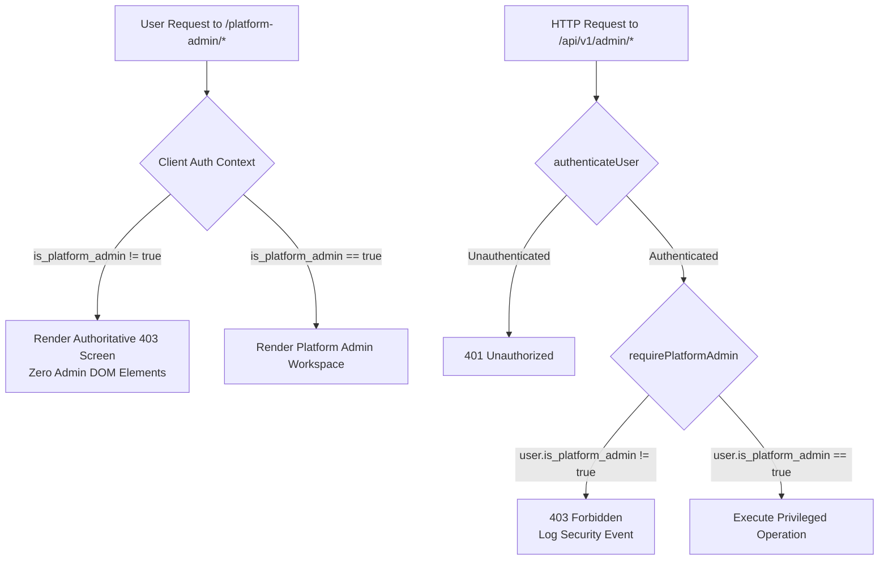

# MIKHLAFI LABS — Platform Administration Route Isolation & Security Architecture

## 1. Security Objective

Customer users and organization administrators must never have access to, visibility of, or the ability to invoke platform administration endpoints or user interfaces. Hiding a button is explicitly rejected as an authorization mechanism.

---

## 2. Defense-in-Depth Implementation



### Layer 1: Client Navigation Scrubbing
- **File:** [`apps/platform/src/components/layout/CustomerLayout.tsx`](file:///d:/mikhlafi-labs/apps/platform/src/components/layout/CustomerLayout.tsx)
- All platform admin navigation items, shortcuts, and footer links were completely removed from the customer workspace layout.

### Layer 2: Authoritative Frontend Route Guard
- **File:** [`apps/platform/src/components/auth/ProtectedRoute.tsx`](file:///d:/mikhlafi-labs/apps/platform/src/components/auth/ProtectedRoute.tsx)
- Inspects `user.is_platform_admin`. If `false`, it terminates rendering immediately and returns an authoritative 403 banner:
```tsx
if (requirePlatformAdmin && !user.is_platform_admin) {
  return (
    <div className="platform-page-container">
      <div className="decision-card critical" style={{ textAlign: 'center', padding: '48px 24px' }}>
        <IconShield size={42} style={{ color: 'var(--status-critical)', marginBottom: '16px' }} />
        <h2 style={{ fontSize: '20px', fontWeight: 800, color: 'var(--text-primary)' }}>
          {isAr ? '403 — الوصول محظور: يتطلب صلاحية إدارة المنصة' : '403 — Forbidden: Platform Administrator Privilege Required'}
        </h2>
        <p style={{ fontSize: '13px', color: 'var(--text-secondary)', maxWidth: '520px', margin: '12px auto' }}>
          {isAr
            ? 'هذه الواجهة مخصصة للإدارة المركزية للمنصة ومحظورة تماماً على حسابات المؤسسات والعملاء.'
            : 'This workspace is restricted to global platform administrators.'}
        </p>
      </div>
    </div>
  );
}
```

### Layer 3: Backend API Middleware Authorization
- **File:** [`apps/api/src/server.js`](file:///d:/mikhlafi-labs/apps/api/src/server.js)
- Middleware `requirePlatformAdmin` enforces `request.auth?.user?.is_platform_admin === true`. Any ordinary customer user or organization administrator receives an immediate HTTP 403 Forbidden with security logging.
- Any unhandled `/api/v1/admin/*` route returns a strict 404 rather than leaking internal middleware state.

---

## 3. Automated Test Evidence

Automated test suite [`apps/api/tests/admin_route_security.test.js`](file:///d:/mikhlafi-labs/apps/api/tests/admin_route_security.test.js) verifies:
1. `GET /api/v1/admin/tenants` returns 401 for unauthenticated requests.
2. `GET /api/v1/admin/tenants` returns 403 for ordinary customer users (`is_platform_admin: false`).
3. `POST /api/v1/admin/tenants` returns 403 when customer users attempt tenant provisioning.
4. `GET /api/v1/admin/metrics` returns 403 for customer workspace owners.
5. Platform admin (`is_platform_admin: true`) successfully accesses privileged endpoints.
6. Non-existent `/api/v1/admin/unknown` routes return 404 cleanly.
