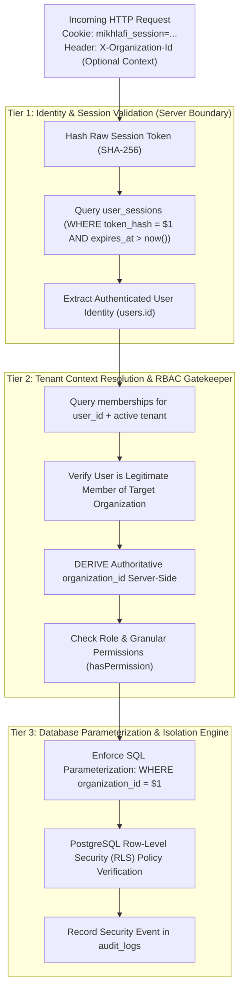
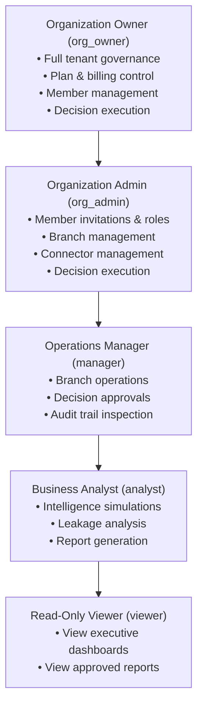

# AUTHORIZATION_AND_TENANT_ISOLATION.md
# MIKHLAFI LABS — Authorization, Multi-Tenant Isolation & Security Architecture
### MULTI-TENANT ISOLATION ARCHITECTURE, RBAC ACCESS CONTROL & DEFENSE-IN-DEPTH SPECIFICATION
**Author:** Principal Security Architect & Backend Lead  
**Version:** 2.0.0 (Master Security Blueprint)  
**Status:** Authoritative Security Architecture & Implementation Standard  
**Repository:** `d:\mikhlafi-labs` (`https://github.com/Saad2003Mouad/MkhlafiLabs`)

---

## 1. Multi-Tenant Defense-in-Depth Architecture

MIKHLAFI LABS implements a three-tier defense-in-depth model to enforce strict tenant isolation across all enterprise data flows:



### 1.1 Non-Negotiable Invariants
1. **Zero Trust in Client-Supplied Tenant IDs:** The server never trusts `organization_id` or `tenant_id` provided in request bodies, query strings, or headers without validating that the authenticated session holds an active membership for that specific tenant.
2. **Deterministic SQL Parameterization:** All SQL queries touching tenant-scoped tables must explicitly bind the server-derived `organization_id` as a parameterized argument (`$1`, `$2`). Raw string concatenation or string interpolation in SQL statements is strictly prohibited.
3. **IDOR Defense (Insecure Direct Object References):** Querying a record by ID (`/api/v1/records/decisions/:id`) must always include `AND organization_id = $2`. If no matching row is found, the server returns HTTP 404 to avoid disclosing whether the record exists in another tenant.

---

## 2. Identity, Credential & Session Management

### 2.1 Password Hashing & Storage
* **Hashing Algorithm:** `argon2id` (memory-hard, resistant to GPU/ASIC brute forcing) with fallback to `bcrypt` (cost factor 12).
* **Storage Invariant:** Plaintext passwords and reversible encryptions are strictly forbidden. The database stores only the salted cryptographic hash in `users.password_hash`.

### 2.2 Server Session Security
* **Session Identifier Generation:** 32 bytes of cryptographically secure pseudorandom entropy (`crypto.randomBytes(32).toString('hex')`).
* **Cryptographic Storage:** The server never stores raw session tokens in the database. Tokens are hashed using `SHA-256` (`crypto.createHash('sha256').update(rawToken).digest('hex')`) and stored in `user_sessions.token_hash`.
* **Cookie Attributes:**
  - `HttpOnly`: Prevents client-side JavaScript access, mitigating Cross-Site Scripting (XSS) session theft.
  - `SameSite=Lax` (or `SameSite=Strict` for sensitive operations): Mitigates Cross-Site Request Forgery (CSRF).
  - `Secure`: Enforced in production to ensure tokens are transmitted only over encrypted TLS/HTTPS connections.
  - `Path=/`: Restricts scope to application root.
* **Session Revocation:** Triggered on logout or administrative session termination by setting `user_sessions.is_revoked = true`.

---

## 3. Granular Role-Based Access Control (RBAC)

### 3.1 Role Hierarchy & Default Assignments



### 3.2 Granular Permissions Matrix

| Permission Identifier | Description | `org_owner` | `org_admin` | `manager` | `analyst` | `viewer` |
|---|---|---|---|---|---|---|
| `org:view` | View organization profile and settings | YES | YES | YES | YES | YES |
| `org:update` | Modify organization preferences and defaults | YES | YES | NO | NO | NO |
| `org:delete` | Delete or archive organization | YES | NO | NO | NO | NO |
| `member:view` | View organization membership directory | YES | YES | YES | YES | NO |
| `member:invite` | Invite new members and assign roles | YES | YES | NO | NO | NO |
| `member:update` | Update member role or branch assignments | YES | YES | NO | NO | NO |
| `member:remove` | Revoke user membership from organization | YES | YES | NO | NO | NO |
| `branch:view` | View branches and business units | YES | YES | YES | YES | YES |
| `branch:manage` | Create, edit, or deactivate branches | YES | YES | NO | NO | NO |
| `decision:view` | View decision radar and recommendations | YES | YES | YES | YES | YES |
| `decision:execute` | Approve or execute mitigation decisions | YES | YES | YES | NO | NO |
| `audit:view` | Inspect organization immutable audit trail | YES | YES | YES | YES | NO |
| `billing:manage` | Manage subscription tier and payment info | YES | NO | NO | NO | NO |
| `connector:manage`| Configure ERP and database data syncs | YES | YES | NO | NO | NO |

---

## 4. Platform Security Hardening & Confirmed Defect Remediation

### 4.1 Confirmed Defect 1: Static Asset Path Traversal (CRITICAL)
* **Vulnerable Location:** `server.js:58-79`
* **Vulnerability Description:** The static `/assets/*` handler concatenates the requested path using `path.join(PLATFORM_DIST, 'assets', path.normalize(assetSub))` without verifying that the resolved path stays within the base directory boundary.
* **Attack Proof:** A raw socket request `GET /assets/../../package.json HTTP/1.1` returned HTTP 200 and leaked `apps/platform/package.json`.
* **Remediation Specification:**
  ```javascript
  const safeBase = path.resolve(PLATFORM_DIST, 'assets');
  const safePath = path.resolve(safeBase, '.' + path.normalize('/' + assetSub));
  if (!safePath.startsWith(safeBase)) {
    res.writeHead(403, { 'Content-Type': 'text/plain' });
    return res.end('Access Denied: Path traversal detected.');
  }
  ```

### 4.2 Confirmed Defect 2: Insecure CORS Preflight & CSRF Exposure (HIGH)
* **Vulnerable Location:** `apps/api/src/server.js:21-31, 61-69`
* **Vulnerability Description:** The server reflects any incoming `Origin` in `OPTIONS` preflight and sets `Access-Control-Allow-Credentials: true`. This allows malicious external websites to make authenticated cross-origin requests using victim cookies.
* **Remediation Specification:** Replace origin reflection with strict origin whitelisting against configured allowed origins (`process.env.WEB_BASE_URL` or local development ports). Requests from unauthorized origins must receive an empty CORS header or HTTP 403.

### 4.3 Confirmed Defect 3: Organization Slug Collision 500 Crash (HIGH)
* **Vulnerable Location:** `apps/api/src/server.js:103-125`
* **Vulnerability Description:** Organization slugs are generated strictly from `orgNameEn` without a collision fallback. Because `organizations.slug` has a `UNIQUE` constraint, duplicate registrations crash with HTTP 500 (`duplicate key value violates unique constraint "organizations_slug_key"`).
* **Remediation Specification:**
  ```javascript
  const baseSlug = orgNameEn.toLowerCase().replace(/[^a-z0-9]+/g, '-').replace(/^-|-$/g, '') || 'org';
  const randomSuffix = crypto.randomBytes(3).toString('hex');
  const orgSlug = `${baseSlug}-${randomSuffix}`;
  ```

---

## 5. Security Audit Logging & Compliance

### 5.1 Immutable Audit Log Schema
All security-relevant actions are recorded synchronously in `audit_logs`:
* `id`: UUID Primary Key
* `organization_id`: UUID foreign key to `organizations` (nullable for global actions)
* `user_id`: UUID foreign key to `users`
* `action`: Structured event identifier (e.g., `USER_LOGIN`, `USER_REGISTERED`, `DECISION_EXECUTED`, `MEMBER_INVITED`)
* `entity_type`: Target entity classification (`USER`, `ORGANIZATION`, `TENANT_DECISION`, `MEMBERSHIP`)
* `entity_id`: Identifier of modified record
* `details`: JSONB payload containing event parameters
* `ip_address`: Client IP address
* `user_agent`: Client user-agent string
* `created_at`: Immutable timestamp (`DEFAULT now()`)

### 5.2 Verification & Automated Test Coverage
Tenant isolation and security controls are validated by automated regression suites:
1. `tests/auth.test.js`: Password hashing verification, session creation, session cookie parsing, session revocation (8/8 tests pass).
2. `tests/tenant-isolation.test.js`: Cross-tenant IDOR attack simulation, RBAC escalation prevention, cross-tenant decision execution blocking (15/15 tests pass).
3. `tests/routes.test.js`: API route validation, health check, registration, login, authenticated tenant endpoints.
