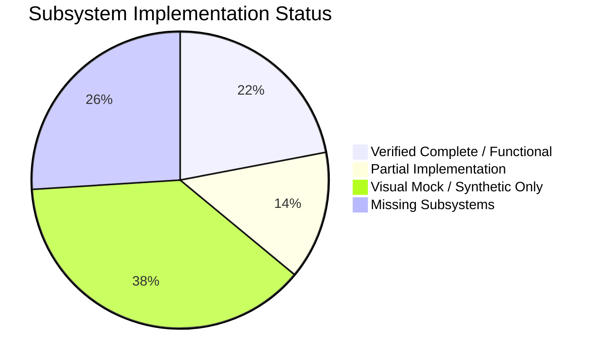

# COMPLETE_REPOSITORY_GAP_ANALYSIS.md
# MIKHLAFI LABS — Complete Repository Gap Analysis
### SYSTEMATIC COMPARISON BETWEEN MASTER PRODUCT SPECIFICATION AND ACTUAL CODEBASE
**Author:** Principal Platform Architect & Senior Software Engineer  
**Version:** 2.0.0 (Master Gap Analysis)  
**Status:** Canonical Audit & Gap Analysis Document  
**Repository:** `d:\mikhlafi-labs` (`https://github.com/Saad2003Mouad/MkhlafiLabs`)

---

## 1. Executive Summary: Target Vision vs. Current Reality

An exhaustive, code-level inspection of all 68 files in the MIKHLAFI LABS repository reveals a codebase with a **strong, verified foundational core** (modern React/Vite architecture, design tokens, dual-engine PostgreSQL 16 database layer, and proven multi-tenant RBAC enforcement), but with significant gaps between documented ambitions and runtime reality:

### High-Level Reality Check
1. **Public Website (Experience A):** High-fidelity, bilingual (AR/EN), responsive, and functional in presentation. However, dynamic CMS capabilities and backend lead intake (`/contact`) are non-existent.
2. **Authentication Gateway (Experience D):** Functional password hashing (`argon2id`/`bcrypt`) and cryptographically secure sessions. However, organization slug collisions crash registrations, and multi-step onboarding is missing.
3. **Customer Workspace (Experience B):** 16 rich UI screens exist, but **only 2 screens** (`ExecutiveDashboard` partially and `DecisionsView` completely) connect to real database records. The intended first intelligence service, **Financial Leak Detection** (`/app/finance`), is currently a **100% visual mock** with hardcoded numbers, mock buttons that mutate local React state, and zero database tables.
4. **Platform Administration (Experience C):** **100% MISSING.** No `/admin/*` router, components, backend endpoints, or operator role validations exist anywhere in the codebase.
5. **Subscription & Entitlement Engine:** **100% MISSING in backend.** Commercial package catalogs and runtime entitlement gates are not implemented in the database or API. The billing screen renders hardcoded mock text.
6. **Critical Security Blockers:** A verified **Path Traversal vulnerability** in `server.js` allows arbitrary file disclosure, an insecure **CORS preflight reflection** exposes sessions to CSRF, and an unhandled **Slug Collision** crashes duplicate organization signups with HTTP 500.

---

## 2. Detailed Subsystem-by-Subsystem Gap Analysis

### 2.1 Public Corporate Website (Experience A)
* **What Exists:**
  - Route separation: `/`, `/about`, `/platform`, `/solutions`, `/industries`, `/pricing`, `/contact`.
  - Responsive design tokens, bilingual toggle (AR-RTL / EN-LTR), theme switcher (dark/light).
  - High-fidelity typography and layout structure.
* **What is Missing or Broken:**
  - Inbound inquiries from `/contact` are not sent to any backend API endpoint. Submitting the form updates only local React component state; zero database persistence or email notifications occur.
  - Public `/pricing` packages are hardcoded in the frontend rather than dynamically fetched from a catalog API.
  - `/privacy` and `/terms` routes are not declared in the router, defaulting to 404.
  - No CMS functionality exists for non-technical marketing updates.

### 2.2 Dedicated Authentication & Onboarding (Experience D)
* **What Exists:**
  - Dedicated `/login` and `/register` pages with form validation and error banners.
  - Server endpoints: `POST /api/v1/auth/login`, `POST /api/v1/auth/register`, `POST /api/v1/auth/logout`, `GET /api/v1/auth/me`.
  - Password hashing via `argon2id`/`bcrypt` with salt; secure session tokens hashed with SHA-256.
  - Automatic creation of default HQ branch and owner membership during registration.
* **What is Missing or Broken:**
  - **CRITICAL DEFECT:** In `apps/api/src/server.js:103`, `orgSlug` is generated directly from `orgNameEn` without a random salt or collision retry. Submitting an existing organization name triggers a PostgreSQL unique constraint violation (`organizations_slug_key`) and crashes the request with HTTP 500.
  - Password recovery (`/forgot-password`, `/reset-password`) is entirely absent.
  - Resumable onboarding (`/onboarding/*`) is not implemented; registration immediately redirects to the dashboard.

### 2.3 Customer Application Workspace Shell & Layout (Experience B)
* **What Exists:**
  - `CustomerLayout.tsx`: Collapsible sidebar, active route detection, breadcrumbs, organization selector badge, theme/locale controls.
  - Protected route guard (`ProtectedRoute.tsx`): Redirects unauthenticated users to `/login?returnUrl=...`.
  - Dedicated 404 handler (`NotFoundPage.tsx`) for unknown application paths.
* **What is Missing or Broken:**
  - Multi-organization switcher is visual-only; users cannot seamlessly toggle between multiple memberships in the UI.
  - Branch selector is static and does not filter view data by `branch_id`.
  - **DEAD CODE:** `apps/platform/src/components/Shell.tsx` (434 lines) and `apps/platform/src/components/common/ScenarioToolbar.tsx` (157 lines) are unmounted, unused, and duplicate active components.

### 2.4 The 8 Canonical Intelligence Services Audit

| Service Number & Identifier | Interface Route | UI Component | Real DB Tables | Real API Endpoints | Current Implementation Reality |
|---|---|---|---|---|---|
| **01. Financial Intelligence** (`financial-intelligence`) | `/app/finance` | `IntelligenceDetail.tsx` | **NONE** | **NONE** | **100% Visual Mock.** Hardcoded case numbers, mock 3-way match. Buttons toggle local React state only. Zero backend tables. |
| **02. Executive Decisions** (`executive-decisions`) | `/app/decisions` | `DecisionsView.tsx` | `tenant_decisions` | `GET /api/v1/records/decisions` `POST /api/v1/records/decisions/:id/execute` | **COMPLETE & VERIFIED.** Real PostgreSQL persistence, strict tenant scoping, RBAC validation (`decision:execute`), audit logging. |
| **03. Risk Intelligence** (`risk-intelligence`) | `/app/risk` | `RiskView.tsx` | **NONE** | **NONE** | **100% Visual Mock.** Static risk registry and 5x5 matrix. No backend tables or endpoints. |
| **04. Project Intelligence** (`project-intelligence`) | `/app/projects` | `ProjectsView.tsx` | **NONE** | **NONE** | **100% Visual Mock.** Static project cards and progress bars. No backend tables or endpoints. |
| **05. Supplier Intelligence** (`supplier-intelligence`) | `/app/suppliers` | `SuppliersView.tsx` | **NONE** | **NONE** | **100% Visual Mock.** Static vendor cards and drift indicators. No backend tables or endpoints. |
| **06. Customer Intelligence** (`customer-intelligence`) | `/app/customers` | `CustomersView.tsx` | **NONE** | **NONE** | **100% Visual Mock.** Static customer accounts and churn percentages. No backend tables or endpoints. |
| **07. AI Business Assistant** (`ai-assistant`) | `/app/assistant` | `AssistantView.tsx` | **NONE** | **NONE** | **100% Visual Mock.** Simulated chat responses with hardcoded sleep delays. No LLM integration or provenance verification. |
| **08. Data Quality Intelligence** (`data-quality`) | `/app/data-quality` | `DataQualityView.tsx` | **NONE** | **NONE** | **100% Visual Mock.** Static reconciliation cards. No automated schema verification engine. |

### 2.5 Platform Administration Control Center (Experience C)
* **What Exists:**
  - Theoretical specification in `docs/TARGET_ARCHITECTURE.md`.
* **What is Missing:**
  - **100% MISSING:**
    - Zero frontend routes under `/admin/*` in `App.tsx` or `routes.ts`.
    - Zero backend endpoints under `/api/v1/admin/*` in `apps/api/src/server.js`.
    - Column `is_platform_admin` was omitted from `apps/api/src/db/migrations/001_initial_schema.sql`.
    - No platform operator role, session guard, or audit logging table (`platform_audit_logs`).

### 2.6 Subscription & Entitlement Engine
* **What Exists:**
  - Architectural intent in `docs/ADR/0002-catalog-entitlements.md`.
  - Static billing mockup in `BillingView.tsx`.
* **What is Missing:**
  - No database tables: `subscription_packages`, `platform_capabilities`, `organization_subscriptions`, `organization_entitlements`, `organization_usage`.
  - No backend middleware: `hasEntitlement(orgId, capabilityId)` does not exist.
  - Quotas (seats, branches, records) are completely unenforced.
  - Invoice downloads show simulated toast alerts with zero PDF generation.

---

## 3. Verified Security & Architectural Defects

| Defect ID | Severity | File & Lines | Defect Description | Verification Evidence | Corrective Remediation |
|---|---|---|---|---|---|
| **SEC-01** | **CRITICAL** | `server.js:58-79` | **Static Asset Path Traversal:** Path concatenation without directory containment verification allows arbitrary file disclosure outside dist. | Executed `GET /assets/../../package.json` -> returned HTTP 200 and leaked `apps/platform/package.json`. | Enforce `safePath.startsWith(safeBase)` using `path.resolve`. Return 403 on boundary escape. |
| **SEC-02** | **HIGH** | `apps/api/src/server.js:21-31, 61-69` | **Insecure CORS & CSRF Exposure:** Origin header is reflected with `Access-Control-Allow-Credentials: true`, permitting unauthorized cross-origin requests with victim cookies. | Code review of CORS headers in `jsonResponse` and `OPTIONS` handler. | Replace origin reflection with explicit whitelist matching (`WEB_BASE_URL` or localhost ports). |
| **SEC-03** | **HIGH** | `apps/api/src/server.js:103-125` | **Organization Slug Collision Crash:** Slug generation lacks collision fallback, triggering PostgreSQL unique constraint error on duplicate org names. | Test 16 in `routes.test.js` failed with HTTP 500 (`500 !== 201`) due to slug collision. | Append cryptographically random 3-byte hex suffix to generated slugs during registration. |
| **ARCH-01** | **MEDIUM** | `apps/api/src/db/connection.js:22-55` | **Ephemeral In-Memory Fallback:** If `DATABASE_URL` is unset, server boots into ephemeral in-memory PGlite; all customer data is lost on process restart. | Code review of connection fallback logic. | Reject in-memory fallback when `NODE_ENV === 'production'`; fail fast if `DATABASE_URL` is missing. |
| **BUILD-01**| **LOW** | `apps/platform/vite.config.js:17-18` | **Disabled Production Minification:** `build.minify: false` causes bundle size to inflate to 612 kB unminified. | Code review of Vite configuration. | Enable `minify: 'esbuild'` or `true` for production builds. |

---

## 4. Master Implementation Status Matrix

| Subsystem Component | UI Space | Backend Route | DB Table | Architectural Status |
|---|---|---|---|---|
| Public Home & Narrative | `/`, `/about` | Static | None | **COMPLETE** |
| Platform Capabilities Overview | `/platform`, `/solutions` | Static | None | **COMPLETE** |
| Public Pricing Comparison | `/pricing` | Static | None | **PARTIAL** (Static mock data) |
| Inbound Inquiries & Demo Booking | `/contact` | Missing | Missing | **VISUAL_MOCK** |
| Dedicated User Authentication | `/login` | `/api/v1/auth/login` | `users`, `user_sessions` | **COMPLETE** |
| Tenant Registration | `/register` | `/api/v1/auth/register`| `users`, `organizations`, `branches` | **PARTIAL** (Slug collision defect) |
| Password Reset Flow | Missing | Missing | Missing | **MISSING** |
| Multi-Step Onboarding Wizard | Missing | Missing | Missing | **MISSING** |
| Customer Layout & Navigation | `/app/*` | `/api/v1/auth/me` | `memberships`, `roles` | **COMPLETE** |
| Executive Overview Dashboard | `/app/overview` | `/api/v1/dashboard/summary` | `tenant_decisions` | **PARTIAL** (Decisions live, others static) |
| Executive Decision Center | `/app/decisions`| `/api/v1/records/decisions` | `tenant_decisions` | **COMPLETE** |
| Financial Leak Detection (Service 1)| `/app/finance` | Missing | Missing | **VISUAL_MOCK** |
| Risk Intelligence | `/app/risk` | Missing | Missing | **VISUAL_MOCK** |
| Project Intelligence | `/app/projects` | Missing | Missing | **VISUAL_MOCK** |
| Supplier Intelligence | `/app/suppliers` | Missing | Missing | **VISUAL_MOCK** |
| Customer Intelligence | `/app/customers` | Missing | Missing | **VISUAL_MOCK** |
| AI Business Assistant | `/app/assistant` | Missing | Missing | **VISUAL_MOCK** |
| Data Quality Intelligence | `/app/data-quality`| Missing | Missing | **VISUAL_MOCK** |
| Organization & Branch Management | `/app/organization`| `/api/v1/organizations/*` | `organizations`, `branches`, `memberships` | **PARTIAL** (Endpoints verified; UI partial) |
| Subscription & Billing Center | `/app/billing` | Missing | Missing | **VISUAL_MOCK** |
| Platform Administration Control Center| `/admin/*` | Missing | Missing | **MISSING** (100% Absent) |
