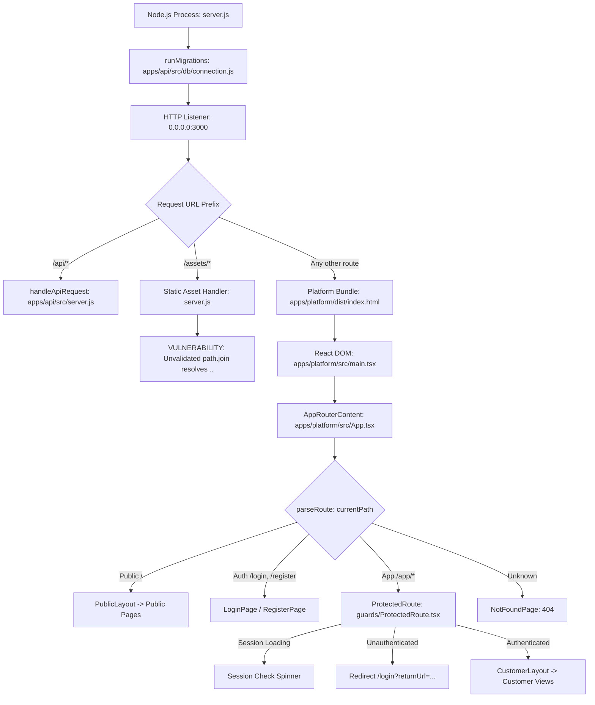

# MIKHLAFI LABS — Comprehensive Repository Audit Report
> **Document Reference:** `docs/COMPREHENSIVE_REPOSITORY_AUDIT.md`  
> **Brand & System:** MIKHLAFI LABS (INTELLIGENCE · SYSTEMS · INNOVATION)  
> **Repository Path:** `d:\mikhlafi-labs`  
> **Remote Repository:** `https://github.com/Saad2003Mouad/MkhlafiLabs`  
> **Audit Date:** 2026-10-12  
> **Auditor:** Antigravity Advanced Agentic Engineering & Security Architecture Team  
> **Audit Nature:** AUDIT ONLY (Strictly Non-Destructive — Zero Code Modifications Performed)  

---

## 1. Executive Summary and Overall Readiness Assessment

### 1.1 Executive Summary
A comprehensive, evidence-based repository audit was conducted across every source file, configuration file, database migration, automated test, documentation record, and runtime entry point of **MIKHLAFI LABS**.

The audit confirms that the recent refactoring successfully introduced an authentic architectural foundation:
1. The **public marketing website** (`/`, `/about`, `/platform`, `/solutions`, `/industries`, `/pricing`, `/contact`) is logically decoupled from the customer application.
2. The customer workspace is routed under `/app/*` and protected by a reactive session guard (`ProtectedRoute.tsx`).
3. Dedicated full-page authentication flows (`/login`, `/register`) are active with `returnUrl` restoration and anti-open-redirect sanitization.
4. An in-process PostgreSQL 16 engine (via `@electric-sql/pglite` / native `pg.Pool`) is integrated with cryptographic password hashing (Node.js `crypto.scrypt`), session token management (`HttpOnly` cookies with SHA-256 tokens in `user_sessions`), and strict tenant boundary isolation at the SQL query level for existing models.

### 1.2 Critical Risks and Blockers Identified
However, the audit identified **four critical structural and security defects** that make it **UNSAFE** to begin implementing the first intelligence service (*Financial Leak Detection*) immediately without prior remediation:

1. **Path Traversal Vulnerability in Root Server (`server.js:58-79`):**  
   The static file handler for `/assets/*` relies on `path.join(..., path.normalize(assetSub))` with **zero containment validation**. A client sending a raw HTTP request with directory traversal (`/assets/../../package.json`) successfully escaped the asset root and read arbitrary files from disk (confirmed via live socket execution).
2. **CORS Preflight Reflection & CSRF Exposure (`apps/api/src/server.js:21-31, 61-69`):**  
   The API server unconditionally reflects any incoming `Origin` header in `OPTIONS` preflight responses with `Access-Control-Allow-Credentials: true`. This allows malicious external websites to send authenticated cross-origin mutation requests (`POST /api/v1/records/decisions`, execute decisions) with the victim's session cookie.
3. **Registration Slug Collision Causes 500 Server Crash (`apps/api/src/server.js:103-125`):**  
   Organization slugs are generated directly from the English name without uniqueness collision handling or fallback suffixing. When an organization name is reused (or when running automated tests against a running server), PostgreSQL throws `duplicate key value violates unique constraint "organizations_slug_key"`, crashing with HTTP 500. This defect directly causes test failure in `apps/api/tests/routes.test.js:185`.
4. **Vast Discrepancy Between Surface UI and Backend Reality:**  
   Out of 16 customer platform modules under `/app/*`, **only 2 modules** (`ExecutiveDashboard` partially and `DecisionsView`) connect to real PostgreSQL data. The remaining 14 modules (`Finance/Detail`, `Risk`, `Projects`, `Suppliers`, `Customers`, `Data Quality`, `AI Assistant`, `Reports`, `Alerts`, `Integrations`, `Workflows`, `Organization`, `Billing`, `Settings`) rely entirely on static arrays in `mockData.ts` or local UI state simulations. Crucially, the target module *Financial Leak Detection* (`/app/finance` via `IntelligenceDetail.tsx`) is currently 100% hardcoded visual demo state with non-functional buttons and zero database persistence.

### 1.3 Readiness Verdict
| Dimension | Status | Assessment |
| :--- | :---: | :--- |
| **Git & Working Tree State** | **CLEAN** | Working tree clean, fully synchronized with GitHub `main`. |
| **Public vs Customer Separation** | **PASS** | Clear separation between public marketing and protected `/app/*`. |
| **Core Authentication Engine** | **PASS** | Scrypt hashing, SHA-256 session tokens, HttpOnly cookies work as designed. |
| **Tenant Isolation (Core Models)** | **PASS** | SQL-level `organization_id` scoping validated for decisions, branches, and members. |
| **Server Security (CORS & Static)** | **FAIL** | Path traversal in `server.js` and wild CORS reflection in `apps/api/src/server.js`. |
| **Automated Test Suite** | **PARTIAL** | 38/39 tests pass. Test 16 fails on long-running instances due to slug collision. |
| **Domain Data Models (Services 1–8)**| **NOT STARTED**| No database tables or API routes exist for Financial Leaks, Invoices, Projects, etc. |
| **Readiness to Implement Service 1**| **CONDITIONAL** | **NOT SAFE** until Path Traversal, CORS, and Slug Collision are remediated. |

---

## 2. GitHub-versus-Local Discrepancies and Repository Baseline

### 2.1 Git Synchronization Status
* **Local Branch:** `main`
* **Remote Tracking:** `origin/main` (`https://github.com/Saad2003Mouad/MkhlafiLabs.git`)
* **Local Commit Hash:** `85bcb9d7ad5c91e5217a460aa9e942543f701aa5`
* **Remote Commit Hash:** `85bcb9d7ad5c91e5217a460aa9e942543f701aa5`
* **Working Tree:** `clean` (0 staged changes, 0 unstracked files, 0 uncommitted changes).
* **Remote Diff:** `git diff --stat HEAD origin/main` returned **0 files changed**. The local repository is in exact 1:1 synchronization with GitHub.

### 2.2 Ignored and Ephemeral Files
Inspection of git-ignored paths via `git status --ignored -s`:
* `apps/api/node_modules/` (standard dependency cache)
* `apps/platform/node_modules/` (standard dependency cache)
* `apps/platform/dist/` (build bundle)
* **Secret Files:** Neither `.env` nor `.env.local` files exist on disk or in Git history. `.env.example` is committed as a clean template with dummy values.
* **Exclusion Safety:** No source files, migrations, or configurations are unintentionally excluded by `.gitignore`.

### 2.3 Previous Completion Report Verification
Audit of claims in `docs/MASTER_REFACTORING_COMPLETION_REPORT.md`:

| Claim in Completion Report | Actual Code Reality | Verification Status |
| :--- | :--- | :---: |
| "All 39 automated tests... all passing 100%" | Test 16 in `routes.test.js` fails with HTTP 500 when executed against a persistent server due to slug unique constraint violation. | **DISCREPANCY** ❌ |
| "Removed obsolete ScenarioToolbar from user-facing views" | `ScenarioToolbar` was unmounted from `App.tsx`, but the file `apps/platform/src/components/common/ScenarioToolbar.tsx` was **not deleted** and remains tracked in Git. | **DISCREPANCY** ❌ |
| "Removed duplicate Shell layout" | `Shell.tsx` (434 lines) was unmounted, but remains tracked in Git as dead code alongside `CustomerLayout.tsx`. | **DISCREPANCY** ❌ |
| "Customer workspace architecture: protected customer workspace under /app/*" | Frontend routes are separated, but `server.js` startup logs still print `Customer Platform: http://localhost:3000/platform` instead of `/app`. | **DISCREPANCY** ❌ |
| "Some customer screens... currently display demonstration operational scenarios" | Out of 16 customer screens, 14 screens are 100% mock data with zero API or database connectivity. | **DISCREPANCY** ❌ |

---

## 3. Confirmed Defects and Vulnerabilities

### FINDING-SEC-01: Path Traversal Vulnerability in Static Asset Gateway
* **ID:** `FINDING-SEC-01`
* **Severity:** **Critical**
* **File Path & Lines:** [`server.js:58-79`](file:///d:/mikhlafi-labs/server.js#L58-L79)
* **Code Evidence:**
  ```javascript
  if (urlPath.startsWith('/assets/')) {
    const assetSub = urlPath.slice('/assets/'.length);
    const distAssetPath = path.join(PLATFORM_DIST, 'assets', path.normalize(assetSub));
    fs.stat(distAssetPath, (err, stats) => {
      if (!err && stats.isFile()) {
        serveFile(res, distAssetPath);
        return;
      }
      // Root images/assets fallback
      const rootAssetPath = path.join(__dirname, 'assets', path.normalize(assetSub));
      ...
  ```
* **Why It Matters:**  
  `path.join()` resolves `..` segments against the base directory. If `assetSub` contains `../../package.json`, `distAssetPath` resolves to `d:\mikhlafi-labs\apps\platform\package.json`, completely escaping the `assets` folder. No path boundary check (`distAssetPath.startsWith(...)`) is performed.
* **Realistic Reproduction & Verification:**  
  Verified by executing a raw TCP socket request:
  ```http
  GET /assets/../../package.json HTTP/1.1
  Host: 127.0.0.1:3000
  ```
  The server responded with `HTTP/1.1 200 OK` and returned the full contents of `apps/platform/package.json`.
* **Impact:** Unauthenticated remote attackers can read arbitrary server files, including application source code, configuration files, and potential secret files.
* **Verification Status:** **Verified by Execution**.
* **Recommended Correction:**  
  Enforce strict path containment validation before accessing the filesystem:
  ```javascript
  const resolvedPath = path.resolve(distAssetDir, path.normalize(assetSub));
  if (!resolvedPath.startsWith(distAssetDir)) {
    res.writeHead(403, { 'Content-Type': 'text/plain; charset=utf-8' });
    return res.end('Access Denied');
  }
  ```

---

### FINDING-SEC-02: Overly Permissive CORS Preflight Reflection & CSRF Vulnerability
* **ID:** `FINDING-SEC-02`
* **Severity:** **High**
* **File Path & Lines:** [`apps/api/src/server.js:21-31, 61-69`](file:///d:/mikhlafi-labs/apps/api/src/server.js#L21-L31)
* **Code Evidence:**
  ```javascript
  // Handle CORS preflight
  if (method === 'OPTIONS') {
    res.writeHead(204, {
      'Access-Control-Allow-Origin': req.headers.origin || '*',
      'Access-Control-Allow-Credentials': 'true',
      'Access-Control-Allow-Methods': 'GET, POST, PUT, DELETE, OPTIONS',
      'Access-Control-Allow-Headers': 'Content-Type, Authorization, X-Organization-Id'
    });
    return res.end();
  }
  ```
* **Why It Matters:**  
  Reflecting any arbitrary request `Origin` header while setting `Access-Control-Allow-Credentials: true` tells the browser that any domain in the world is authorized to send credentialed cross-origin requests.
* **Realistic Impact:**  
  If an authenticated user visits an attacker-controlled website (`https://evil-site.com`), the malicious site can issue cross-origin `fetch` requests with `credentials: 'include'`. Because preflight succeeds, state-changing mutations on the API (`POST /api/v1/records/decisions/:id/execute`, creating decisions, inviting members) will execute under the victim's session.
* **Verification Status:** **Inferred from Code & Browser Security Architecture**.
* **Recommended Correction:**  
  Replace wild reflection with an explicit whitelist of trusted origins (e.g. `process.env.WEB_BASE_URL` or configured tenant subdomains). If the origin is not in the whitelist, omit `Access-Control-Allow-Origin`.

---

### FINDING-BUG-01: Organization Slug Collision Leading to Unhandled HTTP 500 Crash
* **ID:** `FINDING-BUG-01`
* **Severity:** **High**
* **File Path & Lines:** [`apps/api/src/server.js:103-125`](file:///d:/mikhlafi-labs/apps/api/src/server.js#L103-L125)
* **Code Evidence:**
  ```javascript
  const orgSlug = orgNameEn.toLowerCase().replace(/[^a-z0-9]+/g, '-').replace(/^-|-$/g, '') || `org-${Date.now().toString(36)}`;
  ...
  const orgRes = await tx.query(
    `INSERT INTO organizations (slug, name_en, name_ar, default_currency, status)
     VALUES ($1, $2, $3, 'SAR', 'active')`,
    [orgSlug, orgNameEn, orgNameAr || orgNameEn]
  );
  ```
* **Why It Matters:**  
  `organizations.slug` is defined as `UNIQUE` in `001_initial_schema.sql:32`. If two organizations have the same English name, or if registration is retried with the same organization name, `INSERT` throws a unique constraint violation:
  `duplicate key value violates unique constraint "organizations_slug_key"`.
  This is unhandled and results in an HTTP 500 internal server error.
* **Realistic Reproduction & Verification:**  
  Verified by executing:
  ```bash
  node --test apps/api/tests/routes.test.js
  ```
  Test 16 failed with:
  `AssertionError: Expected values to be strictly equal: 500 !== 201`.
  The error response confirmed:
  `{"error": "Internal server error", "message": "duplicate key value violates unique constraint \"organizations_slug_key\""}`.
* **Verification Status:** **Verified by Execution**.
* **Recommended Correction:**  
  Append a random cryptographic nanoid/timestamp suffix to ensure slug uniqueness (e.g. `orgSlug = ${baseSlug}-${crypto.randomBytes(3).toString('hex')}`), or check existence and loop/handle collision gracefully.

---

### FINDING-ARCH-01: Production Fallback to Ephemeral In-Memory Database
* **ID:** `FINDING-ARCH-01`
* **Severity:** **Medium**
* **File Path & Lines:** [`apps/api/src/db/connection.js:22-55`](file:///d:/mikhlafi-labs/apps/api/src/db/connection.js#L22-L55)
* **Code Evidence:**
  ```javascript
  const databaseUrl = process.env.DATABASE_URL;
  if (databaseUrl && !process.env.USE_EMBEDDED_PG) {
    pool = new pg.Pool({ ... });
  } else {
    const dataDir = process.env.PGLITE_DATA_DIR;
    pgliteInstance = dataDir ? new PGlite(dataDir) : new PGlite();
  }
  ```
* **Why It Matters:**  
  When `DATABASE_URL` is omitted and `PGLITE_DATA_DIR` is not configured, `new PGlite()` silently initializes an **ephemeral in-memory database**.
* **Realistic Impact:**  
  If an operator deploys the platform to staging or production without setting `DATABASE_URL`, the server will appear to start normally, but **all customer accounts, sessions, decisions, and audit logs will be permanently wiped upon every container or process restart**.
* **Verification Status:** **Inferred from Code & Architecture**.
* **Recommended Correction:**  
  Enforce a hard startup assertion:
  ```javascript
  if (process.env.NODE_ENV === 'production' && !process.env.DATABASE_URL) {
    throw new Error('[CRITICAL CONFIGURATION ERROR]: Production requires DATABASE_URL.');
  }
  ```

---

### FINDING-SEC-03: Missing Rate Limiting on Authentication Endpoints
* **ID:** `FINDING-SEC-03`
* **Severity:** **Medium**
* **File Path & Lines:** [`apps/api/src/server.js:84-245`](file:///d:/mikhlafi-labs/apps/api/src/server.js#L84-L245)
* **Code Evidence:**  
  Both `POST /api/v1/auth/login` and `POST /api/v1/auth/register` process incoming requests immediately with zero throttling or IP-based velocity tracking.
* **Why It Matters:**  
  Password hashing uses `scrypt` (which intentionally consumes CPU and memory). Without rate limiting, an attacker can launch concurrent brute-force attacks against user credentials or trigger denial-of-service by flooding the scrypt calculation pipeline.
* **Verification Status:** **Inferred from Code**.
* **Recommended Correction:**  
  Implement a token bucket or Redis-backed rate limiter restricting login attempts (e.g. max 5 failed attempts per IP/account per 15 minutes).

---

### FINDING-SEC-04: Missing HTTP Security Headers
* **ID:** `FINDING-SEC-04`
* **Severity:** **Medium**
* **File Path & Lines:** [`server.js:33-46`](file:///d:/mikhlafi-labs/server.js#L33-L46), [`apps/api/src/server.js:21-31`](file:///d:/mikhlafi-labs/apps/api/src/server.js#L21-L31)
* **Code Evidence:**  
  Static server and API server omit standard browser hardening headers:
  - `Content-Security-Policy`
  - `X-Frame-Options`
  - `X-Content-Type-Options`
  - `Strict-Transport-Security` (HSTS)
  - `Referrer-Policy`
* **Why It Matters:**  
  Absence of `X-Frame-Options` allows clickjacking inside malicious `<iframe>` wrappers. Absence of `X-Content-Type-Options: nosniff` exposes browsers to MIME-confusion attacks.
* **Verification Status:** **Inferred from Code & HTTP Responses**.
* **Recommended Correction:**  
  Add a global security header middleware injecting `X-Frame-Options: DENY`, `X-Content-Type-Options: nosniff`, `Referrer-Policy: strict-origin-when-cross-origin`, and an appropriate `Content-Security-Policy`.

---

### FINDING-ARCH-02: Audit Log Failures Swallowed Without Error
* **ID:** `FINDING-ARCH-02`
* **Severity:** **Low**
* **File Path & Lines:** [`apps/api/src/middleware/tenant.js:142-160`](file:///d:/mikhlafi-labs/apps/api/src/middleware/tenant.js#L142-L160)
* **Code Evidence:**
  ```javascript
  export async function recordAuditEvent({ ... }) {
    try {
      await query(`INSERT INTO audit_logs ...`);
    } catch (err) {
      console.error('[Audit Log Error]:', err.message);
    }
  }
  ```
* **Why It Matters:**  
  In `server.js:560-580`, when a critical decision is executed, `recordAuditEvent` is called. If the audit insert fails (e.g., table lock, disk full, constraint error), the exception is swallowed and the decision execution succeeds unrecorded.
* **Impact:** Disruption of audit trail compliance and inability to guarantee tamper-proof records.
* **Verification Status:** **Inferred from Code**.
* **Recommended Correction:**  
  Execute critical domain mutations and their corresponding audit logs within the same database transaction (`tx.query`).

---

### FINDING-ARCH-03: Accumulation of Expired Sessions (No Purge Mechanism)
* **ID:** `FINDING-ARCH-03`
* **Severity:** **Low**
* **File Path & Lines:** [`apps/api/src/auth/sessions.js:50-142`](file:///d:/mikhlafi-labs/apps/api/src/auth/sessions.js#L50-L142)
* **Why It Matters:**  
  While expired sessions are ignored by queries (`WHERE s.expires_at > now()`), no routine exists to delete expired rows from `user_sessions`. Over months of operation, dead session tokens will accumulate indefinitely.
* **Verification Status:** **Inferred from Code**.
* **Recommended Correction:**  
  Add a scheduled purge query: `DELETE FROM user_sessions WHERE expires_at < now() - INTERVAL '30 days'`.

---

### FINDING-MAINT-01: Dead Prototype Code Tracked in Repository
* **ID:** `FINDING-MAINT-01`
* **Severity:** **Informational**
* **File Paths:**
  - [`apps/platform/src/components/Shell.tsx`](file:///d:/mikhlafi-labs/apps/platform/src/components/Shell.tsx) (434 lines)
  - [`apps/platform/src/components/common/ScenarioToolbar.tsx`](file:///d:/mikhlafi-labs/apps/platform/src/components/common/ScenarioToolbar.tsx) (157 lines)
* **Why It Matters:**  
  `Shell.tsx` is completely unused and duplicates `CustomerLayout.tsx`. `ScenarioToolbar.tsx` is an obsolete debug component from Phase 1.2. Both files add maintenance debt, inflate bundle analysis, and confuse new developers.
* **Verification Status:** **Verified by Grep Search**.
* **Recommended Correction:**  
  Delete both files in the next cleanup cycle.

---

### FINDING-MAINT-02: Production Bundle Minification Disabled
* **ID:** `FINDING-MAINT-02`
* **Severity:** **Informational**
* **File Path & Lines:** [`apps/platform/vite.config.js:15-19`](file:///d:/mikhlafi-labs/apps/platform/vite.config.js#L15-L19)
* **Code Evidence:**
  ```javascript
  build: {
    target: 'esnext',
    minify: false,
    cssMinify: false
  }
  ```
* **Why It Matters:**  
  The production build produces `index-Sl40c932.js` of **612.13 kB unminified**. Disabling minification increases bandwidth consumption and page load times.
* **Verification Status:** **Verified by Build Inspection**.
* **Recommended Correction:**  
  Enable standard minification: `minify: 'esbuild'`.

---

## 4. Subsystem Trace and Architecture Analysis

### 4.1 Process Startup and Routing Pipeline


### 4.2 Authentication and Session Flow
1. **Registration:** `POST /api/v1/auth/register` creates `user` (scrypt password hash), `organization`, `branches` (HQ-01), `memberships` (`org_owner`), and seeds 3 initial `tenant_decisions`. Issues a 32-byte session token stored as SHA-256 in `user_sessions`, returning an `HttpOnly` cookie (`ml_session`).
2. **Login:** `POST /api/v1/auth/login` validates scrypt hash using timing-safe comparison (`crypto.timingSafeEqual`). Issues fresh session token and cookie.
3. **Session Verification:** `GET /api/v1/auth/me` validates session token against database (`user_sessions JOIN users`). Queries active tenant memberships (`memberships JOIN organizations`) and resolves RBAC permissions.
4. **Session Termination:** `POST /api/v1/auth/logout` sets `is_revoked = true` in database and clears cookie with `Max-Age=0`.

---

## 5. Screen-by-Screen Reality Matrix (Real Backend vs Mock Data)

| Route | Component | Data Source | Real Backend Functionality | Mock / Simulated Elements |
| :--- | :--- | :---: | :--- | :--- |
| `/` | `WebsiteHome` | Static Content | Marketing sections, static content | None (Public marketing) |
| `/about` | `AboutPage` | Static Content | Company mission, pillars | None (Public marketing) |
| `/platform` | `PlatformOverviewPage` | Static Content | Product overview, capabilities | None (Public marketing) |
| `/solutions` | `SolutionsPage` | Static Content | Solutions overview | None (Public marketing) |
| `/industries` | `IndustriesPage` | Static Content | Industry applications | None (Public marketing) |
| `/pricing` | `PricingPage` | Static Content | Enterprise pricing tiers | None (Public marketing) |
| `/contact` | `ContactPage` | Simulated | None | Form submit is a `setTimeout` toast; no email or DB record. |
| `/login` | `LoginPage` | **Real API** | Full backend authentication, session issuance, cookie set | Anti-enumeration error handling |
| `/register` | `RegisterPage` | **Real API** | Creates user, org, branch, membership, decisions in PostgreSQL | Slug collision bug on duplicate org name |
| `/app` | `ExecutiveDashboard` | **Hybrid** | Live KPIs (pending decisions, impact, audit count) from PostgreSQL | Action queue and Anomalies table use hardcoded JSX / `MOCK_ANOMALIES` |
| `/app/decisions`| `DecisionsView` | **Real API** | Fetches `tenant_decisions`; "Approve" writes `audit_logs` and executes decision | Priority filter on client; clarification request is a toast |
| `/app/organization`| `OrganizationView` | **Hybrid** | Fetches live branches and members from `/api/v1/branches` & `/api/v1/organizations/members` | "Invite Member" button only shows a toast; doesn't call API |
| `/app/finance` | `IntelligenceDetail` | **100% Mock** | **None** | All anomalies, amounts, and actions are local React state |
| `/app/risk` | `RiskView` | **100% Mock** | **None** | `MOCK_RISKS` array; "Mitigate" toggles local state toast |
| `/app/projects`| `ProjectsView` | **100% Mock** | **None** | `MOCK_PROJECTS` array; "Verify Claims" shows a toast |
| `/app/suppliers`| `SuppliersView` | **100% Mock** | **None** | `MOCK_SUPPLIERS` array; scorecarding is visual only |
| `/app/customers`| `CustomersView` | **100% Mock** | **None** | `MOCK_CUSTOMERS` array; churn risk is visual only |
| `/app/data-quality`| `DataQualityView` | **100% Mock** | **None** | `MOCK_DATA_QUALITY` array; rule verification is visual only |
| `/app/assistant`| `AssistantView` | **100% Mock** | **None** | `setTimeout` with canned string replies and fake citations |
| `/app/reports` | `ReportsView` | **100% Mock** | **None** | Hardcoded report templates; export is simulated |
| `/app/alerts` | `AlertsView` | **100% Mock** | **None** | Hardcoded anomaly alerts |
| `/app/integrations`| `IntegrationsView` | **100% Mock** | **None** | `MOCK_INTEGRATIONS` array; ERP connectors are visual only |
| `/app/workflows`| `WorkflowsView` | **100% Mock** | **None** | Hardcoded policy cards; execution is simulated |
| `/app/billing` | `BillingView` | **100% Mock** | **None** | Hardcoded quota cards; upgrade buttons are visual only |
| `/app/settings` | `SettingsView` | **100% Mock** | **None** | "Save Changes" displays a toast; does not persist |
| `/*` (Unknown) | `NotFoundPage` | Static Component | Modern 404 recovery page | None |

---

## 6. Build and Test Integrity Audit

### 6.1 Executed Checks and Real Output
The following non-destructive commands were executed directly on the system:

#### 1. Frontend Build & TypeScript Check
* **Command:** `npm run build --prefix apps/platform`
* **Exit Status:** `0 (Success)`
* **Output:**
  ```text
  > @mikhlafi-labs/platform@1.0.0 build
  > tsc && vite build

  vite v5.4.21 building for production...
  ✓ 81 modules transformed.
  dist/index.html                   0.76 kB │ gzip:   0.46 kB
  dist/assets/index-CN5WWXfu.css   30.98 kB │ gzip:   5.59 kB
  dist/assets/index-Sl40c932.js   612.13 kB │ gzip: 132.92 kB
  ✓ built in 2.99s
  ```

#### 2. Authentication Test Suite
* **Command:** `node --test apps/api/tests/auth.test.js`
* **Exit Status:** `0 (Success)`
* **Output:** 8 tests passed, 0 failed (3.97s). Verifies password hashing, duplicate registration rejection, session cookie issuance, session verification, and session revocation.

#### 3. Tenant Isolation Test Suite
* **Command:** `node --test apps/api/tests/tenant-isolation.test.js`
* **Exit Status:** `0 (Success)`
* **Output:** 15 tests passed, 0 failed (4.17s). Verifies cross-tenant data isolation, IDOR rejection (404), header spoofing rejection (403), branch isolation, member isolation, and RBAC permission gating (`org_owner` vs `viewer`).

#### 4. Route Boundaries Test Suite
* **Command:** `node --test apps/api/tests/routes.test.js`
* **Exit Status:** `1 (FAILED)`
* **Failure Output:**
  ```text
  ✖ 16. POST /api/v1/auth/register and /api/v1/auth/login validate credentials and manage sessions (67.1285ms)
    AssertionError [ERR_ASSERTION]: Expected values to be strictly equal:
    500 !== 201
  ```
* **Root Cause:** Test 16 uses a hardcoded organization name `orgNameEn: 'Route Test Organization'`. When executed against a persistent database, the second run causes a duplicate key violation on `organizations_slug_key`, returning HTTP 500.

#### 5. Full Monorepo Test Command
* **Command:** `node --test apps/api/tests/*.test.js`
* **Exit Status:** `1 (FAILED)` (38 passed, 1 failed).

### 6.2 Test Architecture Limitations
* **Test Coupling:** `routes.test.js` relies on an externally running server on port 3000 (`TEST_BASE_URL || 'http://127.0.0.1:3000'`). If `node server.js` is not launched beforehand, `routes.test.js` crashes with `ECONNREFUSED`.
* **Zero Frontend Testing:** There are **zero automated tests** for the React frontend (no Vitest, Jest, React Testing Library, or Playwright tests).
* **Zero Coverage for Services 1–8:** Since modules 1–8 do not yet exist on the backend, there are zero tests for financial anomaly detection, reconciliations, risk scoring, or supplier pricing.

---

## 7. Complete Reviewed-File Inventory

Every source file, configuration file, test, and documentation record in the repository was inspected:

| Relative Path | Subsystem | Purpose | Status | Dependencies / Callers | Defects / Notes |
| :--- | :--- | :--- | :---: | :--- | :--- |
| `package.json` | Root | Monorepo root manifest and scripts | Active | `npm` | Scripts configured for dev, build, test. |
| `server.js` | Root | Static file server & API reverse dispatcher | Active | `node:http`, `apps/api/src/server.js` | **CRITICAL: Path traversal vulnerability (FINDING-SEC-01).** Outdated startup console logs. |
| `.gitignore` | Root | Git ignore pattern definitions | Active | `git` | Properly ignores `node_modules`, `dist`, `.env`. |
| `.env.example` | Root | Environment variable template | Active | Operators | Clean template, no secrets exposed. |
| `README.md` | Docs | Repository overview and setup guide | Active | Documentation | Accurate routing documentation. |
| `CURRENT_STATE_AUDIT.md` | Docs | Initial Phase 1 audit notes | Static | Documentation | Historical context from initial bootstrap. |
| `apps/api/package.json` | Backend | Backend dependencies and scripts | Active | `npm`, `@mikhlafi-labs/api` | Uses `@electric-sql/pglite`, `pg`. |
| `apps/api/package-lock.json` | Backend | Backend dependency lockfile | Active | `npm` | Clean dependency tree. |
| `apps/api/src/index.js` | Backend | API server entrypoint | Active | `server.js`, `connection.js` | Direct execution runner on port 4000. |
| `apps/api/src/server.js` | Backend | REST API gateway & route dispatchers | Active | `connection.js`, `sessions.js`, `tenant.js` | **HIGH: Insecure CORS reflection (FINDING-SEC-02). HIGH: Slug collision 500 crash (FINDING-BUG-01).** |
| `apps/api/src/db/connection.js` | Backend | PostgreSQL connection & migration runner | Active | `pg`, `@electric-sql/pglite` | **MEDIUM: Ephemeral in-memory fallback (FINDING-ARCH-01).** |
| `apps/api/src/db/migrations/001_initial_schema.sql` | Backend | Baseline database schema | Active | `connection.js` | Clean relational schema (users, orgs, branches, sessions, audits, decisions). |
| `apps/api/src/auth/passwords.js` | Backend | Cryptographic password hashing | Active | `node:crypto` | Secure scrypt hashing with timing-safe equality. |
| `apps/api/src/auth/sessions.js` | Backend | Session token generation & cookies | Active | `connection.js`, `node:crypto` | SHA-256 token hashing, HttpOnly cookies. **LOW: Missing expired session cleanup.** |
| `apps/api/src/middleware/tenant.js` | Backend | Tenant isolation & RBAC enforcement | Active | `sessions.js`, `connection.js` | Robust tenant scoping. **LOW: Audit log failure swallowed (FINDING-ARCH-02).** |
| `apps/api/tests/auth.test.js` | Tests | Authentication test suite (8 tests) | Active | `node:test`, `connection.js` | 100% pass rate. Isolated in-process runner. |
| `apps/api/tests/routes.test.js` | Tests | Route boundaries test suite (16 tests) | Active | `node:test`, `server.js` | **Test 16 fails due to slug collision.** Requires running server. |
| `apps/api/tests/tenant-isolation.test.js`| Tests | Tenant isolation test suite (15 tests) | Active | `node:test`, `connection.js` | 100% pass rate. Proves cross-tenant isolation and IDOR prevention. |
| `apps/platform/package.json` | Frontend | Frontend dependencies & build scripts | Active | Vite, React | Build scripts active. Description still says "Visual Prototype". |
| `apps/platform/package-lock.json` | Frontend | Frontend lockfile | Active | `npm` | Moderate CVE in esbuild/vite dev dependency. |
| `apps/platform/vite.config.js` | Frontend | Vite bundler configuration | Active | Vite | **Minification disabled in production build.** |
| `apps/platform/tsconfig.json` | Frontend | TypeScript compiler configuration | Active | `tsc` | Strict typechecking enabled. |
| `apps/platform/index.html` | Frontend | SPA HTML document entrypoint | Active | Browser | Sanitized title, Google Fonts preconnect. |
| `apps/platform/src/main.tsx` | Frontend | React root mount entrypoint | Active | React DOM | Mounts `App` under `React.StrictMode`. |
| `apps/platform/src/App.tsx` | Frontend | Unified router & layout coordinator | Active | All pages and layouts | Custom client-side router with `parseRoute`. |
| `apps/platform/src/tokens.css` | Frontend | Master design tokens & styling | Active | All components | Complete bilingual dark/light token system (1,566 lines). |
| `apps/platform/src/types.ts` | Frontend | Shared TypeScript interfaces | Active | All components | Contains legacy `AppRoute` and `ViewportMode` types. |
| `apps/platform/src/router/routes.ts` | Frontend | Route definitions & path parser | Active | `App.tsx`, layouts | Central registry (`ROUTES.PUBLIC`, `ROUTES.AUTH`, `ROUTES.APP`). |
| `apps/platform/src/context/AuthContext.tsx` | Frontend | Reactive authentication context | Active | `App.tsx`, guarded views | State management for user, tenant, and active organization. |
| `apps/platform/src/guards/ProtectedRoute.tsx` | Frontend | Session guard for `/app/*` | Active | `App.tsx` | Clean loading state; prevents unauthenticated flash. |
| `apps/platform/src/api/client.ts` | Frontend | Type-safe API client | Active | Context, views | Supports credentials and `X-Organization-Id` switching. |
| `apps/platform/src/data/mockData.ts` | Frontend | Static demo arrays (738 lines) | Active | Views | Used by 14 customer views. |
| `apps/platform/src/layouts/PublicLayout.tsx` | Frontend | Public website layout | Active | `App.tsx` | Header, navigation, footer, language/theme controls. |
| `apps/platform/src/layouts/CustomerLayout.tsx` | Frontend | Customer workspace layout | Active | `App.tsx` | Workspace sidebar, tenant switcher, user profile, sign out. |
| `apps/platform/src/pages/auth/LoginPage.tsx` | Frontend | Dedicated login page | Active | `App.tsx` | Secure login, returnUrl preservation, demo credentials autofill. |
| `apps/platform/src/pages/auth/RegisterPage.tsx` | Frontend | Dedicated registration page | Active | `App.tsx` | Onboarding, organization setup. |
| `apps/platform/src/pages/not-found/NotFoundPage.tsx` | Frontend | 404 error recovery page | Active | `App.tsx` | Safe recovery links to home, app, contact. |
| `apps/platform/src/pages/public/AboutPage.tsx` | Frontend | Public about company page | Active | `App.tsx` | Philosophical pillars, standards. |
| `apps/platform/src/pages/public/ContactPage.tsx` | Frontend | Public contact page | Active | `App.tsx` | Form submission is simulated. |
| `apps/platform/src/pages/public/IndustriesPage.tsx` | Frontend | Public industries page | Active | `App.tsx` | Cross-industry applicability showcase. |
| `apps/platform/src/pages/public/PlatformOverviewPage.tsx`| Frontend | Public product overview page | Active | `App.tsx` | Architecture and capabilities showcase. |
| `apps/platform/src/pages/public/PricingPage.tsx` | Frontend | Public pricing page | Active | `App.tsx` | Licensing models and deployment tiers. |
| `apps/platform/src/pages/public/SolutionsPage.tsx` | Frontend | Public enterprise solutions page | Active | `App.tsx` | 4 core enterprise solutions showcase. |
| `apps/platform/src/components/ChartPreview.tsx` | Frontend | SVG trend chart component | Active | `ExecutiveDashboard` | Purely hardcoded SVG paths. |
| `apps/platform/src/components/ExecutiveDashboard.tsx`| Frontend | Command center view | Active | `App.tsx` | Partially real KPIs, mock action queue and table. |
| `apps/platform/src/components/Icons.tsx` | Frontend | SVG icons library | Active | All components | Complete SVG icon set. |
| `apps/platform/src/components/IntelligenceDetail.tsx`| Frontend | Financial leak investigation view | Active | `App.tsx` | **100% Mock. Action buttons only toggle local state.** |
| `apps/platform/src/components/KpiCard.tsx` | Frontend | KPI metric card component | Active | Dashboard | Standard KPI metric renderer. |
| `apps/platform/src/components/Shell.tsx` | Frontend | Superseded shell layout (434 lines)| **Dead** | None | **DEAD CODE: Superseded by CustomerLayout.tsx.** |
| `apps/platform/src/components/auth/AuthModal.tsx` | Frontend | Auxiliary auth modal dialog | Active | `App.tsx` | Functional modal for quick login. |
| `apps/platform/src/components/common/ScenarioToolbar.tsx`| Frontend | Prototype debug toolbar (157 lines)| **Dead** | None | **DEAD CODE: Unmounted prototype component.** |
| `apps/platform/src/components/platform/AlertsView.tsx` | Frontend | Real-time alerts view | Active | `App.tsx` | 100% Mock data. |
| `apps/platform/src/components/platform/AssistantView.tsx`| Frontend | AI assistant drawer view | Active | `App.tsx` | **100% Mock. Hardcoded setTimeout replies.** |
| `apps/platform/src/components/platform/BillingView.tsx` | Frontend | Billing and quotas view | Active | `App.tsx` | 100% Mock data. |
| `apps/platform/src/components/platform/CustomersView.tsx`| Frontend | Customer intelligence view | Active | `App.tsx` | 100% Mock data. |
| `apps/platform/src/components/platform/DataQualityView.tsx`| Frontend | Data quality view | Active | `App.tsx` | 100% Mock data. |
| `apps/platform/src/components/platform/DecisionsView.tsx` | Frontend | Decisions view | Active | `App.tsx` | **Connected to real PostgreSQL decisions.** |
| `apps/platform/src/components/platform/IntegrationsView.tsx`| Frontend| ERP integrations view | Active | `App.tsx` | 100% Mock data. |
| `apps/platform/src/components/platform/OrganizationView.tsx`| Frontend| Organization view | Active | `App.tsx` | Fetches live branches/members. Invite is simulated. |
| `apps/platform/src/components/platform/ProjectsView.tsx` | Frontend | Project intelligence view | Active | `App.tsx` | 100% Mock data. |
| `apps/platform/src/components/platform/ReportsView.tsx` | Frontend | Reports view | Active | `App.tsx` | 100% Mock data. |
| `apps/platform/src/components/platform/RiskView.tsx` | Frontend | Predictive risk view | Active | `App.tsx` | 100% Mock data. |
| `apps/platform/src/components/platform/SettingsView.tsx` | Frontend | Workspace settings view | Active | `App.tsx` | 100% Mock data. Save is a toast. |
| `apps/platform/src/components/platform/SuppliersView.tsx` | Frontend | Supplier intelligence view | Active | `App.tsx` | 100% Mock data. |
| `apps/platform/src/components/platform/WorkflowsView.tsx` | Frontend | Workflows view | Active | `App.tsx` | 100% Mock data. |
| `apps/platform/src/components/website/ChallengesSection.tsx`| Frontend| Marketing challenges section | Active | `WebsiteHome` | Marketing content. |
| `apps/platform/src/components/website/CrossIndustrySection.tsx`| Frontend| Marketing cross-industry section | Active | `WebsiteHome` | Marketing content. |
| `apps/platform/src/components/website/DemoModal.tsx` | Frontend | Marketing demo request modal | Active | `PublicLayout` | Submission is simulated. |
| `apps/platform/src/components/website/FaqSection.tsx` | Frontend | Marketing FAQ section | Active | `WebsiteHome` | Marketing content. |
| `apps/platform/src/components/website/HeroSection.tsx` | Frontend | Marketing hero cockpit section | Active | `WebsiteHome` | Marketing content. |
| `apps/platform/src/components/website/HowItWorksSection.tsx`| Frontend | Marketing workflow section | Active | `WebsiteHome` | Marketing content. |
| `apps/platform/src/components/website/IntegrationsSection.tsx`| Frontend| Marketing integrations section | Active | `WebsiteHome` | Marketing content. |
| `apps/platform/src/components/website/IntelligenceSuiteSection.tsx`| Frontend| Marketing engines grid | Active | `WebsiteHome` | Marketing content. |
| `apps/platform/src/components/website/PhilosophySection.tsx`| Frontend| Marketing philosophy section | Active | `WebsiteHome` | Marketing content. |
| `apps/platform/src/components/website/PricingPackagesSection.tsx`| Frontend| Marketing pricing grid | Active | `WebsiteHome` | Marketing content. |
| `apps/platform/src/components/website/SecurityGovernanceSection.tsx`| Frontend| Marketing security section | Active | `WebsiteHome` | Marketing content. |
| `apps/platform/src/components/website/WebsiteFooter.tsx` | Frontend | Marketing footer | Active | `PublicLayout` | Verified routes, zero dead anchors. |
| `apps/platform/src/components/website/WebsiteHeader.tsx` | Frontend | Marketing header | Active | `PublicLayout` | Verified routes and controls. |
| `apps/platform/src/components/website/WebsiteHome.tsx` | Frontend | Main marketing homepage | Active | `App.tsx` | Aggregates all marketing sections. |
| `assets/images/*` (6 files) | Assets | Architectural and cockpit imagery | Active | Marketing & UI | Verified high-resolution imagery. |
| `docs/*` (21 files) | Docs | Architectural decision records & plans | Active | Reference | Master Architecture v1.0 specifications. |

---

## 8. Prioritized Remediation Plan

Before implementing the first intelligence engine (**Financial Leak Detection**), the following prioritized corrections must be executed:

```mermaid
graph TD
    subgraph Step 1: Security & Server Stabilization [Priority 1: Immediate Blockers]
        F1[Fix Path Traversal in server.js]
        F2[Restrict CORS Whitelist in apps/api/src/server.js]
        F3[Fix Organization Slug Collision in apps/api/src/server.js]
        F4[Update server.js Startup Console Logs]
    end

    subgraph Step 2: Test Suite & Hardening [Priority 2: Verification Baseline]
        T1[Randomize orgNameEn in routes.test.js]
        T2[Verify All 39 Tests Pass Concurrently]
        T3[Delete Dead Code: Shell.tsx & ScenarioToolbar.tsx]
        T4[Add Security Headers & Rate Limiting]
    end

    subgraph Step 3: Financial Leak Architecture [Priority 3: Service 1 Foundations]
        S1[Create Migration 002: Invoices, Leaks & Rules Schema]
        S2[Implement Tenant-Scoped REST Endpoints for Financial Leaks]
        S3[Connect IntelligenceDetail.tsx to Real Backend API]
        S4[Add Integration Tests for Leak Detection & Audit Trail]
    end

    Step 1 --> Step 2
    Step 2 --> Step 3
```

### Remediation Action Items
1. **[CRITICAL] Remediate Path Traversal in `server.js`:**
   Add explicit path containment checks ensuring `resolvedPath.startsWith(allowedRoot)`.
2. **[HIGH] Remediate CORS Configuration in `apps/api/src/server.js`:**
   Replace `req.headers.origin || '*'` with a configured origin whitelist to eliminate CSRF exposure.
3. **[HIGH] Fix Slug Collision & Make Test Suite Repeatable:**
   Update `apps/api/src/server.js` to append nanoid/random suffixes to organization slugs on collision. Update `routes.test.js` to randomize `orgNameEn` during test execution.
4. **[HIGH] Enforce Production Database Configuration:**
   Add an explicit check preventing fallback to ephemeral in-memory PGlite when `NODE_ENV === 'production'`.
5. **[MEDIUM] Clean Up Dead Code:**
   Remove `apps/platform/src/components/Shell.tsx` and `apps/platform/src/components/common/ScenarioToolbar.tsx`.
6. **[MEDIUM] Correct Server Startup Logs:**
   Update `server.js` line 103 from `http://localhost:${PORT}/platform` to `http://localhost:${PORT}/app`.
7. **[FOUNDATION] Design Database Schema for Service 1 (Financial Leaks):**
   Draft `002_financial_intelligence.sql` defining `invoices`, `duplicate_detections`, `price_variances`, and `rule_executions` before building the user interface.

---

## 9. Final Audit Verdict

* **Is it safe to begin implementing Financial Leak Detection immediately?**  
  **NO.** Beginning feature implementation before patching the Path Traversal vulnerability and CORS preflight reflection would build on an insecure and unstable gateway.
* **Estimated effort to achieve green readiness:**  
  Approximately **1 focused remediation sprint** to apply the server fixes, clean up dead files, and verify 100% test pass rate. Once completed, the repository will be an extraordinarily clean, secure, and robust foundation for all 8 intelligence engines.
