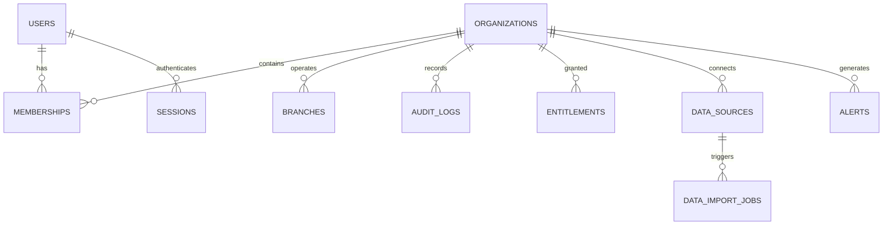

# DATABASE_AND_DOMAIN_MODEL.md
# MIKHLAFI LABS — المخطط البياني ونموذج البيانات الموحد
### COMPREHENSIVE DOMAIN ENTITIES, SCHEMA DEFINITIONS & TENANT BOUNDARIES
**Version:** 1.0.0 (Master Architecture Plan)  

---

## 1. الكيانات الجوهرية وعلاقاتها (Core Entity Relationship Overview)



---

## 2. تفصيل جداول النواة الأساسية (Core Tables Specification)

### 2.1 الهوية والمصادقة (Identity & Authentication)
```sql
CREATE TABLE users (
  id             UUID PRIMARY KEY DEFAULT gen_random_uuid(),
  email          VARCHAR(255) NOT NULL UNIQUE,
  password_hash  VARCHAR(255) NOT NULL,
  name_ar        VARCHAR(150),
  name_en        VARCHAR(150) NOT NULL,
  phone          VARCHAR(50),
  is_verified    BOOLEAN NOT NULL DEFAULT false,
  is_platform_admin BOOLEAN NOT NULL DEFAULT false,
  status         VARCHAR(50) NOT NULL DEFAULT 'active', -- active, suspended, deactivated
  created_at     TIMESTAMPTZ NOT NULL DEFAULT now(),
  updated_at     TIMESTAMPTZ NOT NULL DEFAULT now()
);

CREATE TABLE user_sessions (
  id             UUID PRIMARY KEY DEFAULT gen_random_uuid(),
  user_id        UUID NOT NULL REFERENCES users(id) ON DELETE CASCADE,
  token_hash     VARCHAR(255) NOT NULL UNIQUE,
  ip_address     INET,
  user_agent     TEXT,
  expires_at     TIMESTAMPTZ NOT NULL,
  is_revoked     BOOLEAN NOT NULL DEFAULT false,
  created_at     TIMESTAMPTZ NOT NULL DEFAULT now()
);
```

### 2.2 المؤسسات وتعدد المستأجرين (Organizations & Tenancy)
```sql
CREATE TABLE organizations (
  id             UUID PRIMARY KEY DEFAULT gen_random_uuid(),
  slug           VARCHAR(100) NOT NULL UNIQUE,
  name_ar        VARCHAR(200) NOT NULL,
  name_en        VARCHAR(200) NOT NULL,
  industry_type  VARCHAR(100), -- Dynamic label (e.g. retail, healthcare, services)
  default_currency VARCHAR(10) NOT NULL DEFAULT 'SAR',
  default_locale VARCHAR(10) NOT NULL DEFAULT 'ar',
  timezone       VARCHAR(50) NOT NULL DEFAULT 'Asia/Riyadh',
  status         VARCHAR(50) NOT NULL DEFAULT 'active',
  created_at     TIMESTAMPTZ NOT NULL DEFAULT now(),
  updated_at     TIMESTAMPTZ NOT NULL DEFAULT now()
);

CREATE TABLE branches (
  id              UUID PRIMARY KEY DEFAULT gen_random_uuid(),
  organization_id UUID NOT NULL REFERENCES organizations(id) ON DELETE CASCADE,
  code            VARCHAR(50),
  name_ar         VARCHAR(200) NOT NULL,
  name_en         VARCHAR(200) NOT NULL,
  city            VARCHAR(100),
  is_main_hq      BOOLEAN NOT NULL DEFAULT false,
  status          VARCHAR(50) NOT NULL DEFAULT 'active',
  created_at      TIMESTAMPTZ NOT NULL DEFAULT now()
);

CREATE TABLE memberships (
  id              UUID PRIMARY KEY DEFAULT gen_random_uuid(),
  user_id         UUID NOT NULL REFERENCES users(id) ON DELETE CASCADE,
  organization_id UUID NOT NULL REFERENCES organizations(id) ON DELETE CASCADE,
  role            VARCHAR(50) NOT NULL DEFAULT 'viewer', -- org_owner, org_admin, manager, analyst, viewer
  branch_id       UUID REFERENCES branches(id) ON DELETE SET NULL,
  status          VARCHAR(50) NOT NULL DEFAULT 'active',
  created_at      TIMESTAMPTZ NOT NULL DEFAULT now(),
  UNIQUE(user_id, organization_id)
);
```

### 2.3 التراخيص والكتالوج (Service Catalog & Entitlements)
```sql
CREATE TABLE platform_capabilities (
  id             VARCHAR(50) PRIMARY KEY, -- e.g. financial_intelligence, executive_decisions
  name_ar        VARCHAR(150) NOT NULL,
  name_en        VARCHAR(150) NOT NULL,
  description_ar TEXT,
  description_en TEXT,
  tier_required  VARCHAR(50) NOT NULL DEFAULT 'basic', -- basic (3 mods), advanced (5 mods), premier (8 mods)
  is_active      BOOLEAN NOT NULL DEFAULT true
);

CREATE TABLE organization_entitlements (
  id              UUID PRIMARY KEY DEFAULT gen_random_uuid(),
  organization_id UUID NOT NULL REFERENCES organizations(id) ON DELETE CASCADE,
  capability_id   VARCHAR(50) NOT NULL REFERENCES platform_capabilities(id),
  is_enabled      BOOLEAN NOT NULL DEFAULT true,
  granted_at      TIMESTAMPTZ NOT NULL DEFAULT now(),
  expires_at      TIMESTAMPTZ,
  UNIQUE(organization_id, capability_id)
);
```

### 2.4 تدقيق الأمان ومصادر البيانات (Audit Logs & Data Sources)
```sql
CREATE TABLE audit_logs (
  id              UUID PRIMARY KEY DEFAULT gen_random_uuid(),
  organization_id UUID REFERENCES organizations(id) ON DELETE CASCADE,
  user_id         UUID REFERENCES users(id) ON DELETE SET NULL,
  action          VARCHAR(100) NOT NULL,
  entity_type     VARCHAR(100) NOT NULL,
  entity_id       VARCHAR(100),
  details         JSONB,
  ip_address      INET,
  user_agent      TEXT,
  created_at      TIMESTAMPTZ NOT NULL DEFAULT now()
);
CREATE INDEX idx_audit_logs_org_time ON audit_logs(organization_id, created_at DESC);

CREATE TABLE data_sources (
  id              UUID PRIMARY KEY DEFAULT gen_random_uuid(),
  organization_id UUID NOT NULL REFERENCES organizations(id) ON DELETE CASCADE,
  name            VARCHAR(150) NOT NULL,
  source_type     VARCHAR(50) NOT NULL, -- file_upload, api_connector, database_sync, demo_feed
  connection_config JSONB,              -- Encrypted credentials and options
  status          VARCHAR(50) NOT NULL DEFAULT 'connected',
  last_sync_at    TIMESTAMPTZ,
  created_at      TIMESTAMPTZ NOT NULL DEFAULT now()
);
```

---

## 3. استراتيجية توسيع النماذج للقطاعات (Industry Extensions Strategy)
* بدلاً من إضافة أعمدة متخصصة بكل قطاع إلى جدول `organizations` أو جداول المعاملات، يتم استخدام:
  1. **حقول البيانات المرنة (JSONB Meta Fields):** تخزين المتغيرات الإضافية لكل قطاع دون الحاجة لتغيير هيكل الجداول في كل مرة.
  2. **جداول الامتدادات المنفصلة (Extension Tables):** عند الحاجة لمنطق قطاعي متقدم (مثل `construction_project_phases` أو `retail_store_inventories`)، يتم إنشاء جداول مستقلة ترتبط بالكيان الأصلي عبر `foreign key`، مع تفعيلها فقط للمؤسسات التي تشترك في تلك الإمكانية.

---

## 4. حالة التنفيذ الفعلي — المرحلة الثانية (Phase 2 Implemented State)
- **ملف الترحيل الأولي**: `apps/api/src/db/migrations/001_initial_schema.sql` (مفعل ومطبق بنجاح).
- **طبقة الاتصال**: `apps/api/src/db/connection.js` تدعم الاتصال المزدوج:
  - `pg.Pool` لقواعد بيانات PostgreSQL الخارجية عند ضبط `DATABASE_URL`.
  - `@electric-sql/pglite` كمحرك PostgreSQL 16 داخلي متكامل للتطوير المحلي والاختبارات التلقائية بدون Docker.
- **جداول النواة المنفذة والمختبرة**: `_migrations`, `users`, `organizations`, `branches`, `roles`, `permissions`, `role_permissions`, `memberships`, `user_sessions`, `audit_logs`, `tenant_decisions`.
- **الفحوصات التلقائية**: 23 اختباراً آلياً لاختراق الحدود بين المستأجرين والمصادقة الصارمة (`npm test` بنسبة نجاح 100%).

