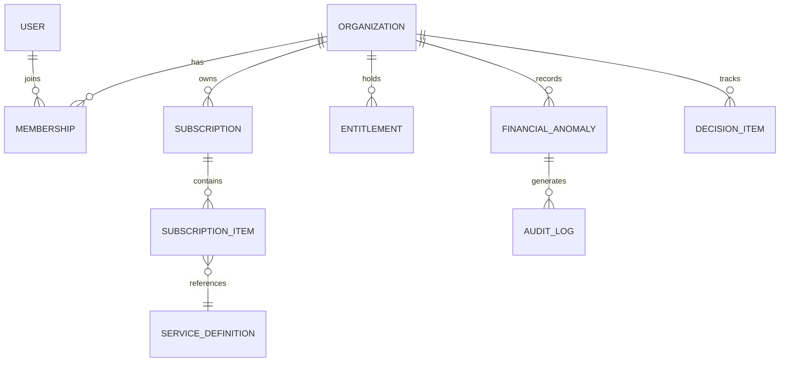

# DATA_MODEL.md — MIKHLAFI LABS Data Specifications
**Version:** 1.0.0  
**Status:** Approved  
**Date:** October 11, 2026  

---

## 1. Core Domain Entities

### Entity Specifications

1. **User:**
   - `id`: UUID (Primary Key)
   - `email`: String (Unique)
   - `full_name`: String
   - `role`: Enum (`PLATFORM_SUPER_ADMIN`, `ORG_OWNER`, `ORG_ADMIN`, `ANALYST_MEMBER`, `READONLY_AUDITOR`)
   - `created_at`: Timestamp

2. **Organization:**
   - `id`: UUID (Primary Key)
   - `legal_name`: String
   - `trade_license_number`: String
   - `currency`: String (e.g. `SAR`)
   - `timezone`: String (e.g. `Asia/Riyadh`)
   - `deployment_mode`: Enum (`CLOUD`, `ON_PREMISE`, `HYBRID`)

3. **ServiceDefinition:**
   - `id`: String (e.g. `financial-intelligence`, `executive-decisions`)
   - `name_ar`: String
   - `name_en`: String
   - `status`: Enum (`DRAFT`, `PUBLISHED`, `DEPRECATED`)
   - `deployment_supported`: Array of strings

4. **FinancialAnomaly:**
   - `id`: String (e.g. `FAN-2026-081`)
   - `organization_id`: UUID
   - `vendor_name`: String
   - `anomaly_type`: Enum (`DUPLICATE_INVOICE`, `PRICE_VARIANCE`, `POLICY_BREACH`, `SCHEDULE_RISK`)
   - `amount`: Decimal
   - `currency`: String
   - `invoice_ref`: String
   - `detection_rule`: String
   - `baseline_reference`: String
   - `confidence_score`: Decimal
   - `status`: Enum (`FLAGGED`, `UNDER_REVIEW`, `AUTHORIZED_HOLD`, `DISMISSED`)
   - `evidence_records`: JSON

5. **DecisionItem:**
   - `id`: String (e.g. `ATT-101`)
   - `organization_id`: UUID
   - `title`: String
   - `severity`: Enum (`CRITICAL`, `HIGH`, `MEDIUM`, `LOW`)
   - `estimated_impact`: Decimal
   - `reason_flagged`: Text
   - `assigned_owner_id`: UUID
   - `due_date`: Timestamp
   - `status`: Enum (`PENDING`, `ASSIGNED`, `IN_PROGRESS`, `RESOLVED`, `DISMISSED`)

6. **AuditLog:**
   - `id`: UUID
   - `organization_id`: UUID
   - `actor_id`: UUID
   - `action_type`: String
   - `target_entity_type`: String
   - `target_entity_id`: String
   - `timestamp`: Timestamp
   - `immutable_hash`: String (SHA-256)

---

## 2. Multi-Tenant Isolation & Security
- Strict multi-tenant isolation enforced at the API and database levels.
- Every read/write query MUST scope to `organization_id`.
- Support engineers require explicit delegated authorization tokens to view redacted diagnostic sessions.
