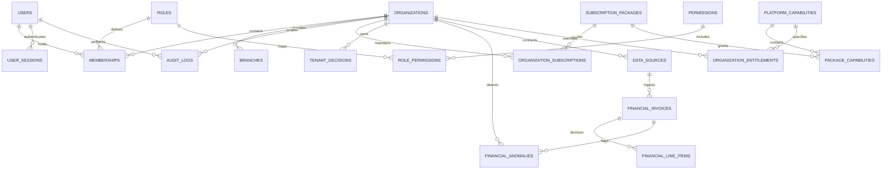
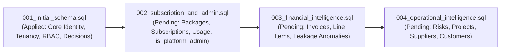

# DOMAIN_MODEL_AND_RELATIONSHIPS.md
# MIKHLAFI LABS — Domain Model, Entity Relationships & Schema Evolution
### COMPREHENSIVE DOMAIN DICTIONARY, ENTITY RELATIONSHIPS & SCHEMA GAP ANALYSIS
**Author:** Principal Data Architect & SaaS Systems Architect  
**Version:** 2.0.0 (Master Domain Blueprint)  
**Status:** Canonical Domain Specification & Entity Architecture  
**Repository:** `d:\mikhlafi-labs` (`https://github.com/Saad2003Mouad/MkhlafiLabs`)

---

## 1. Master Entity-Relationship Overview

The MIKHLAFI LABS domain model is structured into three clear boundaries: **Foundational Identity & Tenancy**, **Commercial Subscriptions & Platform Administration**, and **Intelligence & Operations Engines**:

---

## 2. Inventory of Implemented vs Missing Schema Entities

| Subsystem | Entity Name | Table in Database | Status in `001_initial_schema.sql` | Notes & Architecture Status |
|---|---|---|---|---|
| **Identity** | User | `users` | **IMPLEMENTED** | Missing `is_platform_admin` column in active migration! |
| **Identity** | Session | `user_sessions` | **IMPLEMENTED** | Cryptographically hashed tokens (`token_hash`), IP, user agent. |
| **Tenancy** | Organization | `organizations` | **IMPLEMENTED** | Slug, name AR/EN, currency, locale, timezone, status. |
| **Tenancy** | Branch | `branches` | **IMPLEMENTED** | Branch code, name AR/EN, `is_main_hq`, status. |
| **RBAC** | Role | `roles` | **IMPLEMENTED** | 5 seeded roles (`org_owner`, `org_admin`, `manager`, `analyst`, `viewer`). |
| **RBAC** | Permission | `permissions` | **IMPLEMENTED** | 12 granular permissions across org, member, branch, decision, audit. |
| **RBAC** | Role Permission | `role_permissions` | **IMPLEMENTED** | Many-to-many role-to-permission mapping table. |
| **Tenancy** | Membership | `memberships` | **IMPLEMENTED** | Scoped user-org association with role and branch binding. |
| **Security** | Audit Log | `audit_logs` | **IMPLEMENTED** | Immutable tenant-scoped audit logging trail. |
| **Intelligence**| Tenant Decision | `tenant_decisions` | **IMPLEMENTED** | Proves tenant isolation; impact amounts, risk levels, status. |
| **Commercial** | Capability Catalog | `platform_capabilities` | **MISSING FROM SQL** | Specified in documentation, but omitted from `001_initial_schema.sql`. |
| **Commercial** | Org Entitlement | `organization_entitlements`| **MISSING FROM SQL** | Specified in documentation, but omitted from `001_initial_schema.sql`. |
| **Commercial** | Subscription Package | `subscription_packages` | **MISSING FROM SQL** | Planned for Migration 002. |
| **Commercial** | Organization Subscription| `organization_subscriptions`| **MISSING FROM SQL** | Planned for Migration 002. |
| **Commercial** | Organization Usage | `organization_usage` | **MISSING FROM SQL** | Planned for Migration 002. |
| **Admin** | Platform Operator | `platform_operators` | **MISSING FROM SQL** | Planned for Migration 002. |
| **Admin** | Platform Audit Log | `platform_audit_logs` | **MISSING FROM SQL** | Planned for Migration 002. |
| **Admin** | Inbound Lead Inquiry| `lead_inquiries` | **MISSING FROM SQL** | Planned for Migration 002. |
| **Admin** | Public Website CMS | `cms_content_blocks` | **MISSING FROM SQL** | Planned for Migration 002. |
| **Service 01** | Financial Invoices | `financial_invoices` | **MISSING FROM SQL** | Planned for Migration 003 (Service 1 Implementation). |
| **Service 01** | Financial Line Items| `financial_line_items` | **MISSING FROM SQL** | Planned for Migration 003 (Service 1 Implementation). |
| **Service 01** | Financial Anomalies | `financial_anomalies` | **MISSING FROM SQL** | Planned for Migration 003 (Service 1 Implementation). |

---

## 3. Comprehensive Domain Entity Dictionary

### 3.1 Foundational Identity & Tenancy Entities

#### 1. `users`
* **Purpose:** Represents individual registered humans across the platform.
* **Relationships:** Has many `memberships`, `user_sessions`, and `audit_logs`.
* **Tenant Scope:** Global entity (a user can hold memberships in multiple organizations).
* **Sensitive Data:** Contains `password_hash` (argon2id/bcrypt). Never exposed via API.
* **Persistence & Retention:** Permanent relational storage. Account deactivation sets `status = 'suspended'`.

#### 2. `organizations`
* **Purpose:** The sovereign multi-tenant boundary for an enterprise customer.
* **Relationships:** Has many `branches`, `memberships`, `audit_logs`, `tenant_decisions`, `financial_invoices`.
* **Tenant Scope:** Root tenant container. All operational records reference `organization_id`.
* **Sensitive Data:** Business profile and preferences.
* **Retention Policy:** Data is never deleted on plan suspension. Purging occurs only on formal contractual account closure.

#### 3. `branches`
* **Purpose:** Physical offices, operational hubs, regional centers, or business units.
* **Relationships:** Belongs to `organizations`; referenced optionally by `memberships` and operational records.
* **Tenant Scope:** Scoped strictly to `organization_id`.

#### 4. `memberships`
* **Purpose:** Links a `user` to an `organization` with an assigned `role` and optional `branch_id`.
* **Tenant Scope:** Scoped to `organization_id`. Uniqueness enforced by `UNIQUE(user_id, organization_id)`.
* **Authorization:** Governs all access inside `/app/*`.

#### 5. `user_sessions`
* **Purpose:** Tracks authenticated browser sessions.
* **Tenant Scope:** Belongs to `users`.
* **Sensitive Data:** `token_hash` (SHA-256). Raw tokens never touch the database.

#### 6. `audit_logs`
* **Purpose:** Immutable security and operational audit trail.
* **Tenant Scope:** Scoped to `organization_id` (nullable for global authentication events).
* **Retention Policy:** Append-only. Zero update or delete permissions granted to application roles.

---

### 3.2 Commercial & Subscription Entities (Target Migration 002)

#### 7. `subscription_packages`
* **Purpose:** Definitive catalog of commercial plans (`plan_starter`, `plan_pro`, `plan_enterprise`, `plan_sovereign`).
* **Tenant Scope:** Global platform configuration (managed via `/admin/plans`).
* **Attributes:** Tier level, monthly/annual prices, member seat caps, branch caps, monthly record limits.

#### 8. `platform_capabilities`
* **Purpose:** Master registry of modular capabilities (`financial-intelligence`, `executive-decisions`, etc.).
* **Tenant Scope:** Global platform configuration (managed via `/admin/services`).

#### 9. `organization_subscriptions`
* **Purpose:** Active commercial contract and billing state for an organization.
* **Tenant Scope:** 1-to-1 relationship with `organizations`.
* **Attributes:** Package reference, status (`trialing`, `active`, `past_due`, `suspended`), period dates, grace period.

#### 10. `organization_entitlements`
* **Purpose:** Explicit administrative capability grants or promotional overrides.
* **Tenant Scope:** Scoped to `organization_id`.

#### 11. `organization_usage`
* **Purpose:** Monthly aggregated resource accounting (records processed, API sync volume).
* **Tenant Scope:** Scoped to `organization_id` + calendar period key (`YYYY-MM`).

---

### 3.3 Intelligence Domain Entities (Target Service Migrations)

#### 12. `tenant_decisions` (Implemented)
* **Purpose:** Executive decisions, trade-offs, and operational mitigations.
* **Tenant Scope:** Scoped strictly to `organization_id`.
* **Attributes:** Title, category, impact amount, currency, risk level, status (`PENDING`, `EXECUTED`, `REJECTED`).

#### 13. `financial_invoices` (Target Migration 003 — Service 1)
* **Purpose:** Purchase orders, vendor invoices, disbursement records ingested from ERPs or CSV uploads.
* **Tenant Scope:** Scoped strictly to `organization_id` and optional `branch_id`.
* **Attributes:** Invoice number, vendor name, issue date, due date, total amount, currency, status.

#### 14. `financial_line_items` (Target Migration 003 — Service 1)
* **Purpose:** Granular bill-of-materials and line items associated with financial invoices.
* **Tenant Scope:** Scoped to `financial_invoices` (cascaded by `organization_id`).
* **Attributes:** Description, quantity, unit price, line total, item code hash.

#### 15. `financial_anomalies` (Target Migration 003 — Service 1)
* **Purpose:** Algorithmic leakage flags (duplicate disbursement hashes, pricing drift, unearned payment advances).
* **Tenant Scope:** Scoped strictly to `organization_id`.
* **Attributes:** Detection rule code, confidence score, flagged amount, narrative explanation, resolution status.

---

## 4. Schema Migration & Evolution Roadmap

1. **Migration 001:** Applied and verified in PostgreSQL / PGlite.
2. **Migration 002 (Batch 2):** Adds `users.is_platform_admin`, `subscription_packages`, `platform_capabilities`, `package_capabilities`, `organization_subscriptions`, `organization_entitlements`, `organization_usage`, `lead_inquiries`, `cms_content_blocks`.
3. **Migration 003 (Batch 3):** Powers Service 1 (*Financial Leak Detection*), establishing `financial_invoices`, `financial_line_items`, and `financial_anomalies` with foreign key indexes and tenant scoping.
