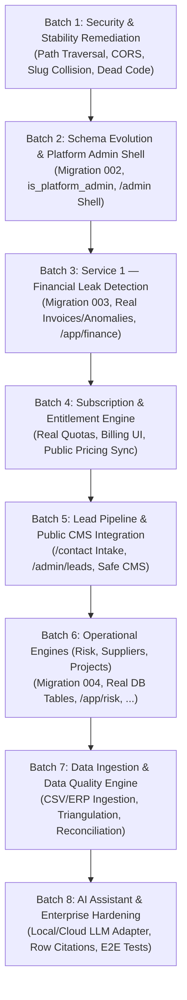

# IMPLEMENTATION_AND_REPAIR_ROADMAP.md
# MIKHLAFI LABS — Implementation & Repair Roadmap
### PHASED, DEPENDENCY-AWARE ENGINEERING SPRINT SPECIFICATION
**Author:** Principal Platform Architect & Senior Software Engineer  
**Version:** 2.0.0 (Master Execution Roadmap)  
**Status:** Authoritative Implementation Blueprint  
**Repository:** `d:\mikhlafi-labs` (`https://github.com/Saad2003Mouad/MkhlafiLabs`)

---

## 1. Roadmap Architecture & Execution Principles

This roadmap organizes the evolution of MIKHLAFI LABS from its current audited state into a fully functional, enterprise-grade SaaS platform. To ensure zero regressions and maintain architectural integrity, all engineering work is structured into **small, controlled, testable batches**:

---

## 2. Phased Implementation Batches

---

### Batch 1: Immediate Security & Stability Remediation
* **Exact Objective:** Neutralize confirmed security vulnerabilities, fix registration crash bugs, clean unmounted legacy dead code, and enable production build minification.
* **Files Involved:**
  - `server.js` (Lines 58–79, 103)
  - `apps/api/src/server.js` (Lines 21–31, 61–69, 103–125)
  - `apps/api/tests/routes.test.js` (Lines 110–120)
  - `apps/platform/vite.config.js` (Lines 17–18)
  - `apps/platform/src/components/Shell.tsx` (Dead code deletion)
  - `apps/platform/src/components/common/ScenarioToolbar.tsx` (Dead code deletion)
* **Prerequisites:** Complete repository audit verified.
* **Expected Changes:**
  1. Patch path traversal in `server.js` by verifying `safePath.startsWith(safeBase)`.
  2. Enforce strict CORS whitelist matching in `apps/api/src/server.js` against configured origins.
  3. Append random hex suffix to generated organization slugs to eliminate duplicate key collisions.
  4. Randomize organization names in `apps/api/tests/routes.test.js` to ensure test idempotency.
  5. Delete unused dead files `Shell.tsx` and `ScenarioToolbar.tsx`.
  6. Set `build.minify: true` in `vite.config.js`.
* **Security Considerations:** Eliminates arbitrary server file disclosure (SEC-01) and cross-origin credentialed request forgery (SEC-02).
* **Tests to Execute:**
  - `node --test apps/api/tests/*.test.js` (All tests must pass 100%, 39/39).
  - Raw socket traversal regression test (`GET /assets/../../package.json` must return 403 Forbidden).
  - Frontend build verification: `npm run build --prefix apps/platform`.
* **Acceptance Criteria:** Zero test failures, zero path traversal vulnerabilities, clean build bundle.
* **Explicit Exclusions:** No new database tables or UI views created during this batch.

---

### Batch 2: Database Schema & Platform Administration Foundation
* **Exact Objective:** Establish foundational database tables for commercial packages, subscriptions, platform operators, and implement the basic Platform Administration interface shell (`/admin/*`).
* **Files Involved:**
  - `apps/api/src/db/migrations/002_subscription_and_admin.sql` (New Migration)
  - `apps/api/src/server.js` (Admin endpoints & operator authentication middleware)
  - `apps/platform/src/router/routes.ts` (Add `/admin/*` route definitions)
  - `apps/platform/src/layouts/AdminLayout.tsx` (New Layout)
  - `apps/platform/src/pages/admin/PlatformOverviewPage.tsx` (New View)
  - `apps/platform/src/guards/AdminRoute.tsx` (New Security Guard)
* **Prerequisites:** Batch 1 completed and verified.
* **Expected Changes:**
  1. Add `is_platform_admin` column to `users` table.
  2. Create tables: `subscription_packages`, `platform_capabilities`, `package_capabilities`, `organization_subscriptions`, `organization_entitlements`, `organization_usage`, `platform_audit_logs`.
  3. Seed initial platform capabilities (8 canonical engines) and standard commercial packages (Starter, Pro, Enterprise).
  4. Implement `requirePlatformAdmin` middleware verifying `is_platform_admin = true`.
  5. Mount `/admin` routes in frontend router with dedicated administrative layout.
* **Security Considerations:** Strict separation of platform operator sessions from customer tenant workspaces. Zero bypass via client-side routing.
* **Tests to Execute:**
  - New test suite: `apps/api/tests/admin-auth.test.js` (Verifies non-operators receive 403 on `/admin` endpoints).
  - Migration idempotency check.
* **Acceptance Criteria:** Platform operator can log in, view live tenant counts, and inspect system health.
* **Explicit Exclusions:** Public CMS management and payment gateway webhooks.

---

### Batch 3: Service 1 — Financial Leak Detection Full Implementation
* **Exact Objective:** Transform the visual-only Financial Intelligence screen (`/app/finance`) into a fully functional, database-backed enterprise intelligence service.
* **Files Involved:**
  - `apps/api/src/db/migrations/003_financial_intelligence.sql` (New Migration)
  - `apps/api/src/services/financial/leakDetection.js` (Detection Engine)
  - `apps/api/src/server.js` (Financial intelligence API routes)
  - `apps/platform/src/components/IntelligenceDetail.tsx` (Wire to real API)
  - `apps/platform/src/api/client.ts` (Typed API client methods)
* **Prerequisites:** Batch 1 & 2 completed.
* **Expected Changes:**
  1. Create tables: `financial_invoices`, `financial_line_items`, `financial_anomalies`.
  2. Implement deterministic algorithmic detection rules:
     - `RULE_DUP_INVOICE_HASH`: Exact duplicate line items + IBAN within 72h window.
     - `RULE_PO_PRICE_DRIFT`: Price variance >10% between Purchase Order and Vendor Invoice.
     - `RULE_EARLY_PAYMENT_DISCOUNT`: Flagging uncaptured vendor cash discounts.
  3. Expose tenant-scoped API endpoints:
     - `GET /api/v1/records/financial-leaks`
     - `GET /api/v1/records/financial-leaks/:id`
     - `POST /api/v1/records/financial-leaks/:id/resolve` (Dismiss or Freeze)
  4. Wire `IntelligenceDetail.tsx` to fetch real database anomalies, display live confidence scores, and execute verified dismissal/freeze actions with immutable audit logs.
* **Security Considerations:** Enforce tenant isolation on every financial invoice query (`organization_id = $1`). Verify user holds `analyst`, `manager`, `org_admin`, or `org_owner` role.
* **Tests to Execute:**
  - New test suite: `apps/api/tests/financial-intelligence.test.js` (Simulates duplicate invoice injection, verifies detection rule firing, verifies cross-tenant isolation).
* **Acceptance Criteria:** Real financial records are queried from PostgreSQL; clicking "Freeze Disbursement" updates database status to `FROZEN` and writes to `audit_logs`.
* **Explicit Exclusions:** Automatic ERP live webhooks (handled via file upload/seed script first).

---

### Batch 4: Commercial Catalog, Subscription & Entitlements Engine Integration
* **Exact Objective:** Connect the customer billing interface (`/app/billing`) and public pricing (`/pricing`) to real backend subscription records, and enforce runtime capability gates.
* **Files Involved:**
  - `apps/api/src/server.js` (Subscription endpoints)
  - `apps/api/src/middleware/tenant.js` (Entitlement checking helper: `hasEntitlement`)
  - `apps/platform/src/components/platform/BillingView.tsx` (Wire to real API)
  - `apps/platform/src/pages/public/PricingPage.tsx` (Fetch dynamic packages)
* **Prerequisites:** Batch 2 completed.
* **Expected Changes:**
  1. Expose `GET /api/v1/billing/current` returning active subscription tier, current period dates, and monthly record consumption.
  2. Wire `BillingView.tsx` to render real organization quotas instead of hardcoded numbers.
  3. Implement `hasEntitlement(orgId, capabilityId)` gatekeeper in API route dispatchers.
* **Security Considerations:** Ensure downgrading an organization immediately revokes access to premium intelligence modules on the server side.
* **Tests to Execute:**
  - Test entitlement gating: An organization with `plan_starter` receives HTTP 403 when requesting `/api/v1/records/financial-leaks`.
* **Acceptance Criteria:** Billing screen reflects active database tier; service access dynamically respects plan limits.

---

### Batch 5: Inbound Leads & Public Website CMS Integration
* **Exact Objective:** Implement backend lead intake for `/contact`, lead management for operators (`/admin/leads`), and dynamic content blocks for public marketing pages.
* **Files Involved:**
  - `apps/api/src/server.js` (Lead submission & CMS API routes)
  - `apps/platform/src/pages/public/ContactPage.tsx` (Wire form submission)
  - `apps/platform/src/pages/admin/LeadsPipelinePage.tsx` (New Admin View)
  - `apps/platform/src/pages/admin/PlatformCmsManagerPage.tsx` (New Admin View)
* **Prerequisites:** Batch 2 completed.
* **Expected Changes:**
  1. Expose `POST /api/v1/inquiries` (Public rate-limited endpoint for contact/demo requests).
  2. Persist inquiries in `lead_inquiries` table with status tracking (`NEW`, `CONTACTED`, `CONVERTED`).
  3. Expose `/api/v1/admin/leads` for platform operators to review and manage inbound requests.
  4. Expose `/api/v1/content/blocks` for dynamic public announcements with XSS sanitization.
* **Security Considerations:** Rate limit public `/api/v1/inquiries` (max 5 submissions per hour per IP) to prevent spam. Sanitize all input fields.
* **Tests to Execute:**
  - Lead submission validation tests; rate limit verification tests.
* **Acceptance Criteria:** Submitting contact form on public website creates verifiable row in `lead_inquiries` visible in platform admin.

---

### Batch 6: Operational Intelligence Engines (Risk, Suppliers, Projects, Customers)
* **Exact Objective:** Transition remaining operational modules (`/app/risk`, `/app/suppliers`, `/app/projects`, `/app/customers`) from visual mocks to database-backed operational tools.
* **Files Involved:**
  - `apps/api/src/db/migrations/004_operational_intelligence.sql` (New Migration)
  - `apps/api/src/server.js` (Operational API endpoints)
  - `apps/platform/src/components/platform/RiskView.tsx`
  - `apps/platform/src/components/platform/SuppliersView.tsx`
  - `apps/platform/src/components/platform/ProjectsView.tsx`
  - `apps/platform/src/components/platform/CustomersView.tsx`
* **Prerequisites:** Batches 1, 2, 3 completed.
* **Expected Changes:**
  1. Create tables: `tenant_risks`, `tenant_suppliers`, `tenant_projects`, `tenant_customers`.
  2. Implement CRUD and status transition endpoints scoped strictly to `organization_id`.
  3. Wire UI views to fetch verified database records and support adding/updating items.
* **Security Considerations:** Cross-tenant IDOR protection enforced on all records.
* **Tests to Execute:**
  - Automated tenant isolation tests across all new operational entities.
* **Acceptance Criteria:** Operational cards reflect real database rows; adding a risk or project persists to PostgreSQL.

---

### Batch 7: Data Ingestion & Data Quality Intelligence Engine
* **Exact Objective:** Enable real data ingestion (CSV upload, JSON sync) and activate the Data Quality Intelligence engine (`/app/data-quality`) to audit schema health, missing fields, and orphan records.
* **Files Involved:**
  - `apps/api/src/services/data/ingestion.js` (Ingestion Parser & Sanitizer)
  - `apps/api/src/services/data/qualityEngine.js` (Integrity Checks)
  - `apps/platform/src/components/platform/DataQualityView.tsx`
  - `apps/platform/src/components/platform/IntegrationsView.tsx`
* **Prerequisites:** Batches 3 and 6 completed.
* **Expected Changes:**
  1. Implement secure CSV file upload parser with row-level validation and 1MB size limits.
  2. Run data quality audits checking for duplicate transaction IDs, missing tax numbers, and orphan line items.
  3. Render live integrity scores in `DataQualityView.tsx`.
* **Security Considerations:** Prevent CSV formula injection (`=`, `@`, `+`, `-` prefixes escaped); enforce file payload limits.
* **Tests to Execute:**
  - Ingestion parser unit tests; formula injection fuzzing tests.
* **Acceptance Criteria:** Uploading a CSV file imports records into `financial_invoices` and displays data quality score.

---

### Batch 8: AI Business Assistant & Sovereign Hardening
* **Exact Objective:** Activate the AI Business Assistant (`/app/assistant`) with strict data provenance (citing specific database rows) and package the entire platform for sovereign, cloud, or offline on-premise execution.
* **Files Involved:**
  - `apps/api/src/services/ai/assistantEngine.js` (LLM Context Builder)
  - `apps/platform/src/components/platform/AssistantView.tsx` (Wire live streaming chat)
  - `docker-compose.yml` (Sovereign deployment configuration)
* **Prerequisites:** Batches 1 through 7 completed.
* **Expected Changes:**
  1. Implement structured context builder querying only verified tenant database records for the prompt context.
  2. Pluggable LLM adapter supporting Google Gemini API or local self-hosted Ollama (for sovereign offline setups).
  3. Strict data provenance: Assistant responses include citations linking to specific invoice or decision IDs.
  4. Configure unified `docker-compose.yml` for self-contained deployment.
* **Security Considerations:** Tenant data isolation in prompt construction; zero prompt injection leakage across organizations.
* **Tests to Execute:**
  - Prompt boundary verification tests; citation integrity verification.
* **Acceptance Criteria:** AI Assistant answers questions based strictly on customer data and cites verified row IDs.
