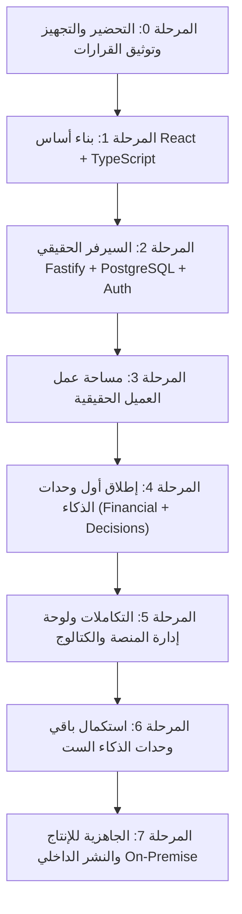

# IMPLEMENTATION_ROADMAP.md
# MIKHLAFI LABS — خارطة طريق التنفيذ المرحلي المنضبط
### MASTER PHASED IMPLEMENTATION SEQUENCE (PHASES 0 TO 7)
**Version:** 1.0.0 (Master Architecture Plan)  
**Status:** Approved Master Roadmap  

---

## المبادئ الحاكمة للتنفيذ (Execution Rules)
1. **استمرار عمل العرض التجريبي:** يجب أن يظل العرض التجريبي الأصلي على `localhost:3000` يعمل دون أي انقطاع خلال جميع مراحل الترحيل.
2. **عدم تأجيل React و TypeScript:** البدء بهما فوراً في بنية الواجهة الجديدة دون أي كود Vanilla JS مؤقت.
3. **لا ميزة تكتمل بدون اختبار:** كل واجهة وخاصية برمجية يجب أن تتضمن اختبارات نوعية وتحقق من الأخطاء.
4. **تجنب اختلاق نتائج أو بيانات زائفة:** شاشات الحالة الصريحة والفارغة (Honest Empty States) هي المعيار بدلاً من الأرقام الوهمية.

---

## المراحل التنفيذية المتسلسلة (Phases Breakdown)

---

### المرحلة 0 — التحضير والتجهيز وتوثيق القرارات (Repository & Architecture Prep)
* **الهدف:** توثيق القرارات المعمارية المعتمدة، تجهيز بيئة العمل، وحماية العرض التجريبي الأصلي.
* **المهام الرئيسية:**
  * تدقيق حالة المستودع و Git وتحديد الملفات المحفوظة.
  * إنشاء وثائق الخطة الـ 12 المعتمدة في `docs/`.
  * إعداد `.env.example` ونموذج ضبط البيئة.
  * الحفاظ التام على تشغيل `node server.js` الأصلي في منفذ التطوير.
* **معايير القبول:** وجود كافة الوثائق الـ 12 ومطابقتها للمتطلبات دون كسر أي شفرة موجودة.

---

### المرحلة 1 — بناء أساس تطبيق React و TypeScript (React/TS Foundation)
* **الهدف:** تأسيس البنية البرمجية الحقيقية للواجهة بنظام React و TypeScript و Vite مع إطلاق النماذج البصرية الأولية.
* **المهام الرئيسية:**
  * تهيئة بيئة React و TypeScript و Vite في مجلد مستقل ومنظم (`apps/platform`).
  * بناء طبقة الرموز الدلالية ونظام التصميم (`packages/design-system` و `packages/ui`).
  * تفعيل السمات (Light / Dark) وتبديل اللغات وتوافق RTL/LTR الكامل.
  * بناء هيكل الشاشات المشترك (Application Shell: Sidebar + Header).
  * إنشاء النماذج البصرية التفاعلية الخمسة (Visual Prototypes A, B, C, D, E) وتشغيلها محلياً.
* **معايير القبول:** إمكانية تصفح النموذج البصري في المتصفح والتبديل بين الوضع الليلي والنهاري وتغيير اللغة من العربية للإنجليزية دون أخطاء برمجية.

---

### المرحلة 2 — السيرفر الحقيقي، PostgreSQL، والمصادقة (Real Backend & DB)
* **الهدف:** تشغيل خادم Fastify وقاعدة بيانات PostgreSQL مع المصادقة الحقيقية المشفرة وإدارة المؤسسات.
* **المهام الرئيسية:**
  * استبدال الـ Stubs في `apps/api` بخادم Fastify متكامل ومهيأ بالـ TypeScript.
  * ربط مجمع اتصالات Drizzle ORM بقاعدة بيانات PostgreSQL وتفعيل الـ Migrations الأولى.
  * إنشاء جداول `users`, `organizations`, `branches`, `memberships`, `user_sessions`.
  * تفعيل تسجيل الدخول المشفر بـ `argon2id` وإصدار الـ Cookies الآمنة.
  * بناء واختبار عزل المستأجرين (Tenant Isolation) على مستوى السيرفر.
* **معايير القبول:** تسجيل مستخدم حقيقي في قاعدة البيانات، إنشاء مؤسسة، والتحقق من منع وصول أي مستخدم إلى بيانات مؤسسة أخرى.

---

### المرحلة 3 — مساحة عمل العميل الحقيقية (Real Customer Workspace)
* **الهدف:** ربط واجهة React بسيرفر الـ API الحقيقي واستعراض مساحة العمل وبيانات المؤسسة.
* **المهام الرئيسية:**
  * ربط خطافات البيانات في React بنقاط الـ API المشفرة عبر عميل `Typed API Client`.
  * عرض مؤشرات الأداء الحقيقية للمؤسسة، مع توفير شاشات انتظار أنيقة وشاشات فارغة صادقة للبيانات الجديدة.
  * دعم وضع العرض التجريبي المدار (Controlled Demo Mode) بعلامة واضحة.
* **معايير القبول:** تسجيل الدخول من واجهة React والدخول المباشر إلى لوحة قيادة المؤسسة الحقيقية واستعراض فروعها وأعضائها.

---

### المرحلة 4 — إطلاق أول إمكانات ذكاء الأعمال (First Intelligence Capabilities)
* **الهدف:** بناء وتفعيل أول وحدتين تخصصيتين: *Financial Intelligence* و *Executive Decision Center*.
* **المهام الرئيسية:**
  * تحديد نماذج البيانات الحسابية ومؤشرات الانحراف وتسرب الأموال.
  * بناء واجهات التصفية والجداول والرسوم البيانية المخصصة للتحليل المالي والقرارات التنفيذية.
  * إضافة اختبارات خوارزميات كشف الشذوذ والتحقق من شفافية مصادر التوصيات.
* **معايير القبول:** تشغيل شاشات التحليل المالي والقرارات التنفيذية بناءً على بيانات المؤسسة وتقديم نتائج واضحة ومفسرة.

---

### المرحلة 5 — التكاملات، إدارة المنصة، والكتالوج التجاري (Integrations & Admin)
* **الهدف:** بناء لوحة الإدارة العليا (`/admin/*`)، إدارة كتالوج الخدمات، والباقات والتراخيص.
* **المهام الرئيسية:**
  * عزل مسارات `/admin/*` بصلاحية مشغل المنصة (Platform Operator) فقط.
  * بناء شاشات إدارة المؤسسات، تفعيل وتعطيل وحدات الذكاء حسب الباقة، ومراقبة صحة النظام.
  * تجهيز طبقة موصلات استيراد البيانات وملفات Excel/CSV.
* **معايير القبول:** إمكانية ترقية باقة مؤسسة من لوحة الإدارة وينعكس فورياً تفعيل أو حجب الوحدات في واجهة العميل.

---

### المرحلة 6 — استكمال باقي وحدات الذكاء الست (Remaining 6 Intelligence Modules)
* **الهدف:** تطوير وتشغيل باقي وحدات الذكاء تدريجياً:
  1. ذكاء المخاطر (Risk Intelligence).
  2. ذكاء المشاريع (Project Intelligence - قطاعي اختياري).
  3. ذكاء الموردين (Supplier Intelligence).
  4. ذكاء العملاء (Customer Intelligence).
  5. المساعد الذكي للأعمال (AI Business Assistant مع تجريد المزود السحابي والمحلي).
  6. ذكاء جودة البيانات (Data Quality Intelligence).
* **معايير القبول:** كل وحدة تحتوي على شاشات مكتملة، اختبارات مستقلة، وصلاحيات دقيقة.

---

### المرحلة 7 — الجاهزية للإنتاج والنشر الداخلي (Production & On-Premise Readiness)
* **الهدف:** الفحص الأمني الشامل، ضبط النسخ الاحتياطي، وإعداد حزم النشر السحابي والداخلي.
* **المهام الرئيسية:**
  * تدقيق أمني شامل (Security hardening: CSP, HSTS, Rate Limiting, Audit).
  * إعداد ملفات `docker-compose.yml` وعكس النطاق مع Caddy.
  * توثيق أدلة التثبيت والتشغيل في بيئات On-Premise في `docs/DEPLOYMENT.md`.
* **معايير القبول:** تشغيل الحزمة الكاملة بضغطة زر واحدة `docker compose up -d` في أقل من دقيقتين واختبار الاستعادة من النسخ الاحتياطي بنجاح.
