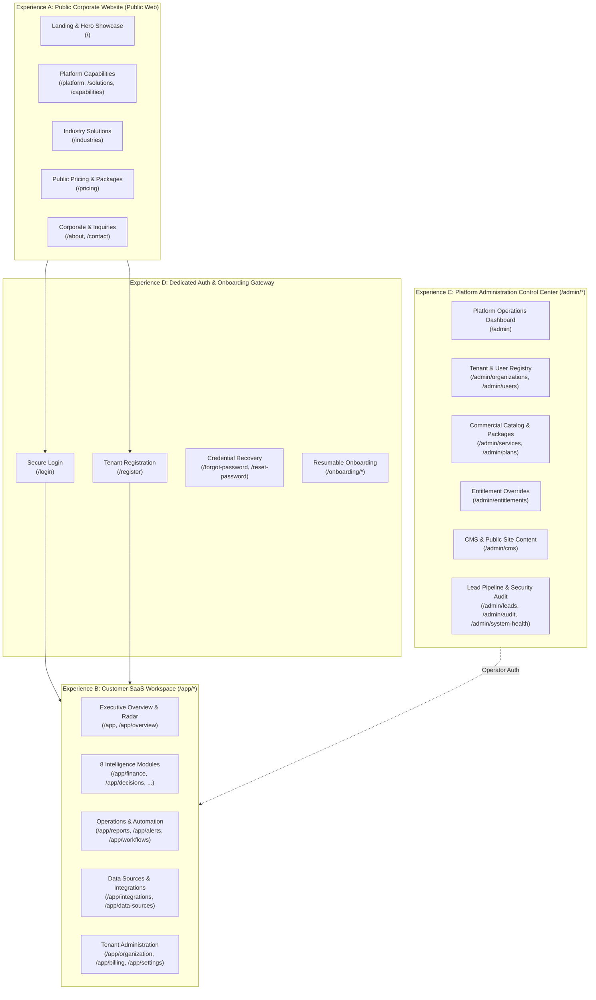
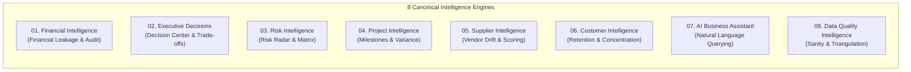

# MASTER_PRODUCT_SPECIFICATION.md
# MIKHLAFI LABS — Master Product Vision & Complete Platform Specification
### INTELLIGENCE · SYSTEMS · INNOVATION
**Author:** Principal Product & Platform Architect  
**Version:** 2.0.0 (Canonical Enterprise Blueprint)  
**Status:** Authoritative Product & Technical Specification  
**Repository:** `d:\mikhlafi-labs` (`https://github.com/Saad2003Mouad/MkhlafiLabs`)

---

## 1. Product Vision, Brand Positioning & Core Mission

### 1.1 Brand Identity & Promise
* **Product Name:** MIKHLAFI LABS
* **Brand Descriptor:** INTELLIGENCE · SYSTEMS · INNOVATION
* **Brand Statement:**
  > *"Building technology that helps businesses make better decisions."*  
  > *"بناء تقنيات ذكية تمكّن الشركات من اتخاذ قرارات أعمال استثنائية وأكثر دقة."*

### 1.2 Core Product Definition
MIKHLAFI LABS is a modular, cross-industry enterprise intelligence and operations platform. It is engineered to provide executive leadership and operational teams with an integrated, high-fidelity lens into enterprise operations:
1. **Operational Understanding:** Unifying disparate telemetry and transaction flows across procurement, projects, finance, and customer touchpoints into an actionable operational picture.
2. **Anomaly & Leakage Detection:** Algorithmic identification of financial leakage, duplicate disbursements, pricing drift, milestone variances, and inventory/resource waste before losses compound.
3. **Risk Mitigation:** Quantitative risk scoring across working capital, supply chains, project governance, and compliance.
4. **Unified Decision Layer:** Surfacing trade-offs, opportunity costs, and evidence-backed recommendations directly tied to verified business data.
5. **Decoupled Intelligence Engines:** Delivering specialized analytical modules (financial leakage, decision radar, supplier drift, data quality) as independently licensable and activatable capabilities.

### 1.3 Cross-Industry Neutrality Principles
The core architecture is strictly **cross-industry neutral**:
* **Supported Business Archetypes:**
  - Retail, Wholesale & E-commerce
  - Professional Services, Consulting & Legal
  - Healthcare, Clinics & Medical Services
  - Manufacturing, Assembly & Industrial Distribution
  - Construction, Engineering & Project-Based Contracting
  - Logistics, Fleet & Freight Transportation
  - Hospitality & Commercial Property Management
  - Diversified Holding Groups & Multi-entity Conglomerates
* **Architectural Invariants:**
  - The shared foundation (`core`) must never hardcode domain-specific assumptions (e.g., assuming currency is always SAR, assuming invoices are always construction progress billings, or assuming a user is always an engineer).
  - All industry-specific requirements are implemented as modular **Domain Extensions** and dynamic configuration profiles.
  - Localization and currency are scoped to the customer organization context (`organizations.default_currency`, `organizations.default_locale`, `organizations.timezone`).

### 1.4 Coexistence Model (Explicit Non-Goals)
* **Not an ERP or Core Accounting Replacement:** MIKHLAFI LABS does not function as a double-entry general ledger, human capital management system, or factory-floor MES. It is an analytical intelligence, verification, and decision-support layer sitting atop existing systems (SAP, Oracle, Odoo, Zoho, Microsoft Dynamics, QuickBooks, or custom SQL databases).
* **Not a Single-Page Monolith:** Public marketing, customer workspace, and platform administration are strictly segregated routing and security spaces.
* **No Fictitious Intelligence Claims:** Visual dashboards must never present simulated or random numbers as real business facts. When real data is absent, the system renders honest, actionable empty states.

---

## 2. The Three Primary Experiences

The platform is structured into three distinct, decoupled experiences sharing design tokens and security primitives:

### Experience A: Public Corporate Website
* **Audience:** Prospective enterprise clients, evaluators, partners, and public visitors.
* **Objective:** Professional brand authority, capability education, subscription tier transparency, and conversion via direct registration or sales demo inquiry.
* **Security Scope:** Completely public; zero customer data exposed. All public CMS content is static or served via read-only public endpoints with aggressive caching.

### Experience B: Customer SaaS Application Workspace (`/app/*`)
* **Audience:** Authenticated tenant organization owners, administrators, analysts, and operators.
* **Objective:** Day-to-day operational analysis, anomaly investigation, decision execution, team collaboration, and data integration management.
* **Security Scope:** Strictly protected by session authentication and server-validated tenant scoping (`organization_id`). Access to specific screens and capabilities is governed by effective plan entitlements and granular RBAC permissions.

### Experience C: MIKHLAFI LABS Platform Administration (`/admin/*`)
* **Audience:** Authorized MIKHLAFI LABS internal platform operators and super administrators only.
* **Objective:** Commercial package catalog management, tenant lifecycle operations (suspension/reactivation), platform health monitoring, system-wide audit inspection, and website CMS publication.
* **Security Scope:** Isolated operator zone protected by `is_platform_admin` validation. Zero client-side cross-talk with customer workspace routes.

---

## 3. Comprehensive User Roles & Permissions Matrix

| User Type | Context | Role Identifier | Capabilities | Restrictions & Security Boundaries |
|---|---|---|---|---|
| **Public Visitor** | Public Web | `anonymous` | Browse public pages, evaluate pricing, submit contact/demo forms, initiate registration. | Zero access to `/app/*`, `/admin/*`, or private APIs. |
| **Registered User (Pending Setup)** | Onboarding | `onboarding_user` | Complete organization profile, select initial tier/evaluation, invite initial team members. | Cannot access analytical engines until tenant workspace creation completes. |
| **Customer Organization Owner** | Customer Workspace | `org_owner` | Full administrative control of own tenant: manage billing/plan, invite/remove members, manage branches, configure integrations, execute decisions. | Scoped strictly to own `organization_id`. Cannot access platform administration or other tenants. |
| **Customer Administrator** | Customer Workspace | `org_admin` | Manage organization members, configure data connectors, manage branches, view audit trail, review intelligence findings. | Cannot delete organization or transfer primary ownership. Scoped strictly to own `organization_id`. |
| **Customer Analyst / Operator** | Customer Workspace | `analyst` / `manager` | Run intelligence simulations, investigate anomalies, view reports, execute approved operational decisions. | Cannot manage billing, subscription plans, or member invitations. Scoped to own `organization_id` (and branch if assigned). |
| **Read-Only Member** | Customer Workspace | `viewer` | Read-only inspection of approved dashboards, decision history, and exported reports. | No mutation privileges. Cannot trigger analysis runs, execute decisions, or modify settings. |
| **Platform Super Administrator** | Platform Admin | `platform_super_admin` | Global tenant management, package definitions, capability catalog toggles, global audit inspection, system diagnostics. | Governed by dual-authenticated operator sessions. All actions logged in `platform_audit_logs`. |
| **Internal Operations / Support** | Platform Admin | `platform_support` | Inspect tenant health, review failed integration jobs, view public leads, update CMS content blocks. | Least-privilege access. Cannot alter billing packages or access raw tenant financial data without audited temporary authorization. |

---

## 4. The Canonical 8 Intelligence Services

The platform documentation establishes 8 canonical intelligence domains:

1. **Financial Intelligence (`financial-intelligence`):** Forensic detection of financial leakage, duplicate invoice disbursements, PO-to-invoice price drift, uncaptured discounts, and tax/reconciliation anomalies.
2. **Executive Decisions (`executive-decisions`):** Actionable decision radar quantifying monetary impact, trade-offs, and risk ratings with full execution lifecycle tracking.
3. **Risk Intelligence (`risk-intelligence`):** Enterprise risk registry tracking probability, impact scores, mitigation ownership, and cross-department risk exposures.
4. **Project Intelligence (`project-intelligence`):** Milestone tracking, earned value analysis, schedule variance, and budget drift for project-driven organizations.
5. **Supplier Intelligence (`supplier-intelligence`):** Vendor performance profiling, single-source dependency risk, contract compliance, and supplier pricing drift.
6. **Customer Intelligence (`customer-intelligence`):** Revenue concentration risks, customer activity velocity, churn risk indicators, and account lifetime profitability.
7. **AI Business Assistant (`ai-assistant`):** Contextual natural-language inquiry over verified organization records with strict data provenance (citing specific database rows, never hallucinating).
8. **Data Quality Intelligence (`data-quality`):** Schema validation, orphan record detection, duplicate key auditing, and cross-system reconciliation health.

---

## 5. Commercial Packages & Subscription Tiers

Commercial packages govern service entitlements, member seats, branch limits, and monthly record quotas:

| Package Tier | Target Customer Profile | Included Intelligence Engines | Quotas & Limits | Support Level |
|---|---|---|---|---|
| **Starter / Evaluation** | Small firms, boutique practices | 3 Engines: Financial, Decisions, Data Quality | 1 Branch, 5 Members, 100K Records/mo | Community & Docs |
| **Professional** | Mid-market businesses, regional ops | 5 Engines: Financial, Decisions, Risk, Suppliers, Data Quality | 5 Branches, 25 Members, 1M Records/mo | Standard Business (SLA 24h) |
| **Enterprise Suite** | Multi-branch enterprises, corporations | All 8 Engines: Full Suite including AI Assistant & Projects | Unlimited Branches, 100 Members, 10M Records/mo | Priority Dedicated (SLA 4h) |
| **Custom / Sovereign** | Large groups, government, on-premise | All 8 Engines + Custom Extensions & Sovereign Air-gapped Mesh | Custom Capacity, Dedicated Deployment | 24/7 Dedicated Support & SLA |

---

## 6. End-to-End Enterprise Lifecycles

### 6.1 Registration & Onboarding Lifecycle
1. Visitor browses public pricing (`/pricing`) or landing page (`/`).
2. Visitor clicks "Get Started" -> Navigates to `/register`.
3. System provisions new user, password hash (`argon2id`/`bcrypt`), new tenant organization, default HQ branch, and assigns `org_owner` role in an atomic database transaction.
4. Server generates cryptographically secure session, writes secure `HttpOnly` cookie, and logs `USER_REGISTERED` audit event.
5. User is seamlessly redirected to `/app` (or onboarding setup wizard).

### 6.2 Service Entitlement & Execution Lifecycle
1. User navigates to `/app/finance`.
2. Frontend requests `/api/v1/records/financial-leaks`.
3. Backend middleware verifies authenticated session (`authenticateRequest`), resolves organization context (`resolveTenantContext`), and checks capability entitlement (`hasEntitlement(orgId, 'financial-intelligence')`).
4. Backend executes parameterized SQL query strictly filtered by `WHERE organization_id = $1`.
5. Frontend renders verified records or an honest empty state with data connector guidance.

---

## 7. Open Business Decisions Required from Platform Owner

The following items represent strategic business decisions that must be explicitly established rather than inferred:
1. **Commercial Payment Gateway:** Selection of primary payment processor (e.g., Stripe, HyperPay, Moyasar, or manual bank wire confirmation for enterprise subscriptions).
2. **Transactional Email Provider:** Selection of transactional email provider for password resets and member invitations (e.g., Resend, AWS SES, Postmark).
3. **AI Provider Strategy:** Decision regarding hosted LLM provider for the Assistant module (e.g., Gemini API, Anthropic, or self-hosted local Ollama instance for sovereign air-gapped deployments).
4. **Free Trial Duration & Enforcement:** Definition of evaluation period rules (e.g., 14-day free trial vs. restricted freemium tier).
