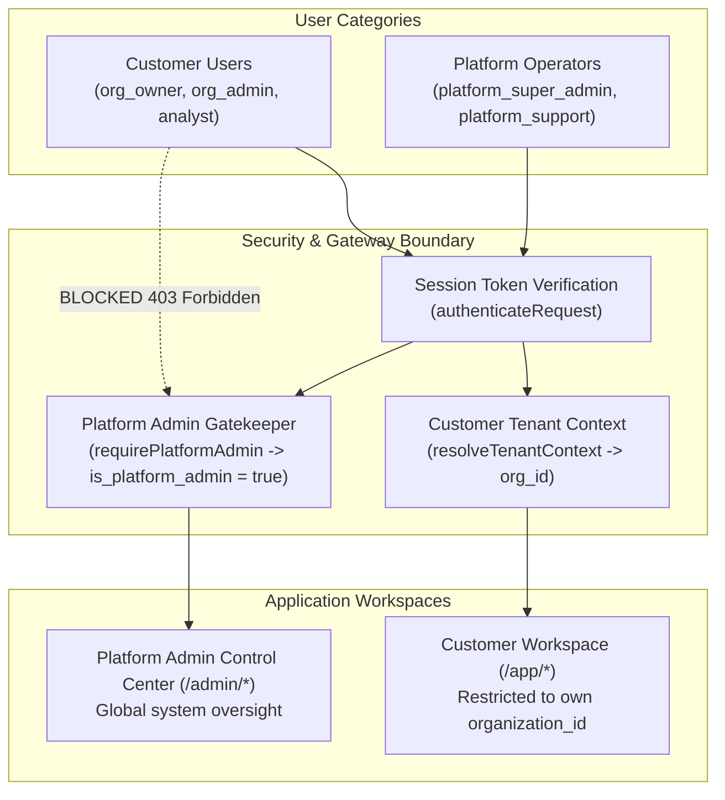

# PLATFORM_ADMINISTRATION_SPECIFICATION.md
# MIKHLAFI LABS — Platform Administration Control Center Specification
### INTERNAL CONTROL CENTER FOR PLATFORM OPERATORS, TENANT MANAGEMENT & SYSTEM OPERATIONS
**Author:** Principal Platform Architect & Security Architect  
**Version:** 2.0.0 (Master Platform Admin Blueprint)  
**Status:** Canonical Administrative Specification  
**Repository:** `d:\mikhlafi-labs` (`https://github.com/Saad2003Mouad/MkhlafiLabs`)

---

## 1. Architectural Role & Security Boundary

The MIKHLAFI LABS Platform Administration interface (`/admin/*`) is the private operational command center for the platform owner, executive leadership, and authorized internal operators. It is architecturally and cryptographically decoupled from customer tenant workspaces:

### Non-Negotiable Invariants
1. **Server-Side Enforcement:** Platform administrative rights are never inferred from client state, URL routing, or organization roles. Access requires `users.is_platform_admin = true` verified against PostgreSQL in every administrative API request.
2. **Customer Isolation:** An `org_owner` of an enterprise customer has zero administrative privileges over the MIKHLAFI LABS platform.
3. **Audit Trail Completeness:** Every mutation performed in the administrative interface (tenant suspension, package edit, manual entitlement override, impersonation) generates an immutable, non-deletable record in `platform_audit_logs`.

---

## 2. Dedicated Administrative Modules & Interfaces

### 2.1 Access & Session Security (`/admin/login` & Middleware)
* **Access Control:** Dedicated administrative route or elevated authentication challenge.
* **Security Requirements:**
  - Session cookies configured with `HttpOnly`, `SameSite=Strict`, and `Secure` attributes.
  - Idle session timeout enforced at 30 minutes for administrative contexts.
  - Rate limiting on administrative login endpoints (maximum 5 attempts per 15 minutes per IP).
  - Explicit logging of all failed operator authentication attempts with IP address and user-agent.

### 2.2 Platform Overview Dashboard (`/admin`)
* **Purpose:** Executive platform intelligence and operational health metrics.
* **Metrics Rendered:**
  1. **Total Registered Organizations:** Breakdown by status (`active`, `trialing`, `suspended`, `archived`).
  2. **Active Subscriptions:** Distribution across commercial tiers (`plan_starter`, `plan_pro`, `plan_enterprise`, `plan_sovereign`).
  3. **Aggregated Processing Volume:** Total ledger records audited across all tenants during the current calendar month.
  4. **Active Job & Queue Health:** Background worker status, pending asynchronous tasks, and failed job count.
  5. **System Error Velocity:** Unhandled application errors logged in the last 24 hours.
* **Verification Invariant:** Metrics must be calculated dynamically from real database records (`COUNT(*)`, `SUM()`). If a metric cannot be calculated reliably, the UI displays an explicit `UNAVAILABLE` state rather than a simulated or hardcoded figure.

### 2.3 Customer & Organization Management (`/admin/organizations`)
* **Capabilities:**
  - **Global Directory:** Search and filter organizations by name, slug, industry, subscription tier, and creation date.
  - **Tenant Detail View (`/admin/organizations/:id`):** Inspect primary owner details, branch list, active member count, connected ERP sources, and monthly record consumption.
  - **Lifecycle Actions:**
    - **Suspend Tenant:** Temporarily revoke tenant API access due to payment default or security violation. Sets `organizations.status = 'suspended'`. Preserves all tenant data intact.
    - **Reactivate Tenant:** Restores an organization to `active` status.
    - **Archive Tenant:** Marks tenant as archived after verified contract termination, queuing for compliant retention/purge workflows.
  - **Audit Logging:** Every status alteration requires an operator reason and is logged to `platform_audit_logs`.

### 2.4 Global User Management (`/admin/users`)
* **Capabilities:**
  - Global search by email, name, or phone across all tenant organizations.
  - View account verification status (`is_verified`) and membership associations.
  - **Session Revocation:** Instantly terminate all active sessions for a compromised account by setting `user_sessions.is_revoked = true`.
  - **Account Deactivation:** Suspend user login globally.
* **Security Invariant:** Password hashes (`password_hash`), session raw tokens, and sensitive integration credentials are **never exposed** in the user interface or API responses.

### 2.5 Commercial Package & Pricing Management (`/admin/plans`)
* **Capabilities:**
  - Create and configure subscription packages (`subscription_packages`).
  - Configure monthly and annual pricing in SAR and USD.
  - Set resource caps: maximum member seats, maximum branches, and monthly ledger record limits.
  - Map included platform capabilities to each package (`package_capabilities`).
  - Publish or deprecate packages without breaking active subscriptions for existing customers.

### 2.6 Subscription Administration (`/admin/subscriptions`)
* **Capabilities:**
  - List and filter active, trialing, past due, and canceled customer subscriptions.
  - Inspect billing intervals, renewal dates, and payment history.
  - **Manual Payment Confirmation:** Record verified offline wire transfers or purchase order contracts for enterprise clients with mandatory invoice reference numbers and operator audit records.
  - Grant grace period extensions for pending enterprise renewals.

### 2.7 Service & Capability Catalog Switchboard (`/admin/services`)
* **Capabilities:**
  - Global register of all platform capabilities (`platform_capabilities`).
  - Global kill-switch: Temporarily disable an intelligence engine across the entire platform during critical maintenance without deleting customer configurations.
  - Configure capability metadata, customer-facing descriptions, and minimum required tier levels.

### 2.8 Service Operations & Background Job Monitoring (`/admin/jobs`)
* **Capabilities:**
  - Inspect asynchronous job queues (data ingestion, forensic audit calculations, batch report generation).
  - Inspect failed jobs with sanitized error messages and stack traces.
  - Trigger idempotent job retries or cancel stalled jobs.
  - Ensure zero credential exposure in job payloads or logs.

### 2.9 Public Website Content Management (`/admin/cms`)
* **Capabilities:**
  - Manage public marketing copy without requiring code commits or redeployments:
    - Homepage hero headline, subtitle, and primary call-to-action.
    - Platform architectural summary and feature highlights.
    - Public announcement banners (e.g., maintenance schedules, product releases).
    - Corporate contact email and phone details.
* **Security Invariant:** All CMS text inputs are sanitized server-side to prevent Cross-Site Scripting (XSS). Direct execution of arbitrary JavaScript or HTML tags is prohibited.

### 2.10 Inbound Lead & Inquiry Pipeline (`/admin/leads`)
* **Capabilities:**
  - Centralized inbox for submissions from `/contact` and enterprise demo requests.
  - Track inquiry status: `NEW`, `IN_REVIEW`, `CONTACTED`, `CONVERTED`, `ARCHIVED`.
  - Assign internal operator ownership and log follow-up notes.
  - Securely handle contact personal data in compliance with data privacy regulations.

### 2.11 Platform Staff & Operator RBAC (`/admin/staff`)
* **Capabilities:**
  - Manage internal platform operators.
  - Assign granular platform operator roles:
    - `platform_super_admin`: Full access to packages, billing, tenant lifecycle, and staff management.
    - `platform_support`: Read-only tenant diagnostics, lead management, and safe job retries.
    - `platform_content`: Access restricted to the Public Website CMS module.
  - Restrict operator creation exclusively to existing super administrators.

### 2.12 Global Platform Settings & Maintenance (`/admin/settings`)
* **Capabilities:**
  - Enable platform-wide **Maintenance Mode** (displays branded maintenance page for customers while allowing operator access).
  - Configure default tenant regional presets (currency: SAR, timezone: Asia/Riyadh, locale: Arabic).
  - Configure system notification webhook endpoints (e.g., Slack/Discord alerts for critical server errors).

### 2.13 Global Security Audit Log (`/admin/audit`)
* **Capabilities:**
  - Read-only, cryptographically ordered audit trail of all security-sensitive events across the platform.
  - Filter by actor, target tenant, event type (`TENANT_SUSPENDED`, `OPERATOR_LOGIN`, `PACKAGE_UPDATED`), and date range.
  - Export audit logs to structured CSV or JSON for compliance auditing.

### 2.14 Platform Health & Technical Diagnostics (`/admin/system-health`)
* **Capabilities:**
  - Live PostgreSQL connection pool telemetry (active connections, idle connections, waiting queries).
  - Redis cache hit/miss ratios and memory usage (where deployed).
  - Process uptime, memory footprint, and CPU utilization.
  - Recent unhandled error stream with sanitized diagnostic contexts.

### 2.15 Customer Support & Scoped Impersonation Policy
* **Policy Statement:** Impersonating customer tenant workspaces is permitted strictly for diagnosing customer-reported defects.
* **Mandatory Safeguards:**
  1. **Audited Consent:** Impersonation requires explicit customer authorization or support ticket reference.
  2. **Prominent Visual Indicator:** When an operator enters a customer workspace, an unclosable high-contrast banner is rendered: `"PLATFORM OPERATOR SUPPORT SESSION ACTIVE — ACTOR: [email]"`.
  3. **Read-Only Default:** Support sessions default to read-only mode to prevent unintended data alteration.
  4. **Non-Repudiation:** All queries and actions performed during the session are tagged with both the operator ID and the target tenant ID in `audit_logs`.
