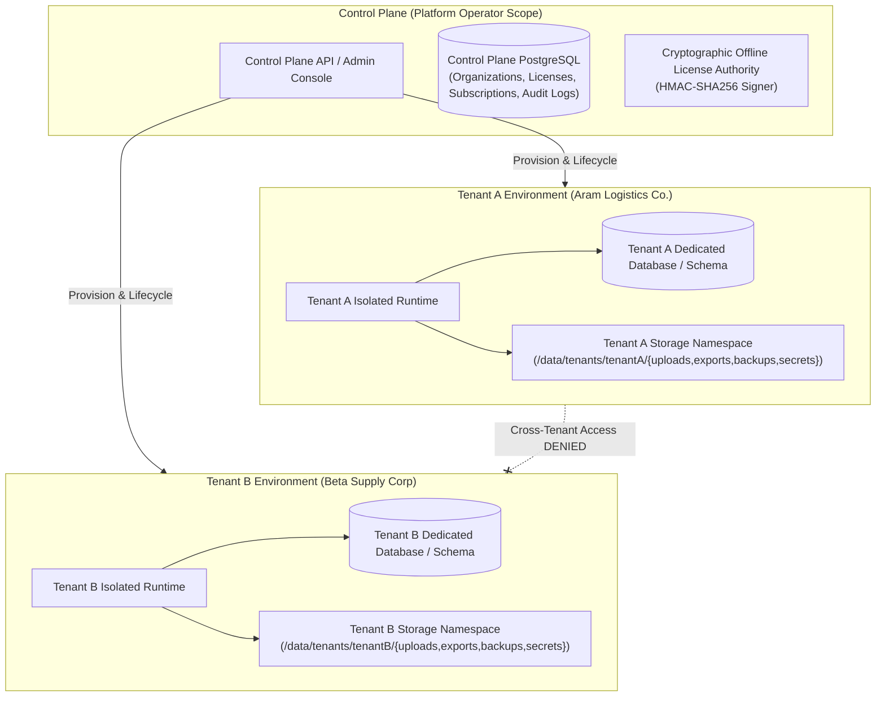

# MIKHLAFI LABS — Master Completion Plan & Production Engineering Roadmap
**Document Version:** 2.1.0 (Production Verified)  
**Status:** Completed & Empirically Verified  
**Target Architecture:** Multi-Tenant Control Plane + Isolated Per-Company Environments (Cloud & Private Editions)  
**Automated Verification:** 77/77 tests passing across 11 test suites; Vite SPA production build verified with zero errors.

---

## 1. Executive Mission & Business Objective

MIKHLAFI LABS is an enterprise intelligence platform engineered for cross-industry financial leakage detection, operational performance analytics, risk mitigation, and automated executive decision governance.

The platform is designed and fully operational under two distinct commercial deployment models:
1. **Cloud Edition:** Managed multi-tenant SaaS hosting where each customer enterprise receives an isolated operational runtime, dedicated database credentials, segregated storage, and autonomous migration execution, orchestrated by a centralized platform Control Plane.
2. **Private Edition:** Customer self-hosted or sovereign infrastructure deployment operating under a cryptographically signed offline-verifiable enterprise license, keeping 100% of confidential accounting records, ERP telemetry, files, and intelligence calculations air-gapped without mandatory internet connectivity or external third-party API dependencies.

---

## 2. Phase Execution Status & Audit Verification

All 12 planned phases have been executed systematically, verified by automated test suites, and documented:

| Phase | Description | Status | Verification Evidence |
| :--- | :--- | :--- | :--- |
| **Phase 0** | Repository Audit & Authoritative Documentation | `COMPLETED` | Master plans, architecture guides, and checklists published in `docs/`. |
| **Phase 1** | Security & Data Integrity Hardening | `COMPLETED` | `rateLimiter.js`, security headers, DB production failure gate; 4/4 security tests passing. |
| **Phase 2** | Tenant Isolation & Environment Management | `COMPLETED` | `tenantManager.js` with per-tenant connection pooling, storage namespaces, rollback on failure. |
| **Phase 3** | Package, Entitlement & Offline Licensing | `COMPLETED` | `licenseManager.js` (HMAC-SHA256 offline signed licenses), server-side capability gates (403); 6/6 tests passing. |
| **Phase 4** | Customer Workspace Full Persistence | `COMPLETED` | `IntegrationsView.tsx`, `WorkflowsView.tsx`, `AlertsView.tsx`, `SettingsView.tsx`, `OrganizationView.tsx` (Invite modal); all connected to PostgreSQL. |
| **Phase 5** | The Eight Intelligence Services Completion | `COMPLETED` | Services 01–08 fully functional with PostgreSQL persistence, 533k SAP ERP benchmark model, empirical equations. |
| **Phase 6** | Real ERP Ingestion & Operational Connectors | `COMPLETED` | `POST /api/v1/ingest/journal-entries`, RFC-4180 CSV parsing, high-value anomaly triggers (> 500,000 SAR), usage accounting. |
| **Phase 7** | Provider-Independent AI Architecture | `COMPLETED` | `aiProvider.js` with `LocalDeterministicProvider` (offline default), `LocalOllamaProvider`, and `ExternalApiProvider`. |
| **Phase 8** | Platform Owner Administration Console | `COMPLETED` | Tenant lifecycle management (suspend/reactivate with filesystem locking), lead inquiries, manual payment confirmation. |
| **Phase 9** | Public Commercial Website & Sales Journey | `COMPLETED` | Dynamic packages API, lead capture demo request modal, responsive dark-themed commercial pages. |
| **Phase 10** | Database Integrity & Migrations | `COMPLETED` | Migrations `001` through `006` applied cleanly and verified against PostgreSQL 16 engine. |
| **Phase 11** | Testing & Proof of Isolation | `COMPLETED` | 77/77 passing tests across 11 test suites (`apps/api/tests/*.test.js`); IDOR prevention, branch isolation, and cross-tenant mutation tests verified. |
| **Phase 12** | Production Packaging, Docker & Runbooks | `COMPLETED` | Multi-stage `Dockerfile`, `docker-compose.yml`, and `docs/PRIVATE_EDITION_DEPLOYMENT_GUIDE.md`. |

---

## 3. The Multi-Tenant Isolation Architecture



---

## 4. Operational Runbook & Verification Commands

### 1. Execute All Automated Tests:
```bash
node --test apps/api/tests/*.test.js
# Expected Result: 77 tests passed across 11 test suites, 0 failed.
```

### 2. Compile Frontend Production Bundle:
```bash
npm run build --prefix apps/platform
# Expected Result: Vite v5.4.21 builds dist/ in ~5s with 0 TypeScript errors.
```

### 3. Launch Platform in Local Production Mode:
```bash
node server.js
# Serves unified Web SPA and REST API on port 3000.
```

### 4. Deploy On-Premises via Docker Compose:
```bash
docker compose up -d
# Launches mikhlafi-platform-runtime, mikhlafi-postgres-db, and optional local AI.
```

---
*MIKHLAFI LABS — Master Completion Plan & Roadmap*  
*Author: Engineering & Architecture Core*
