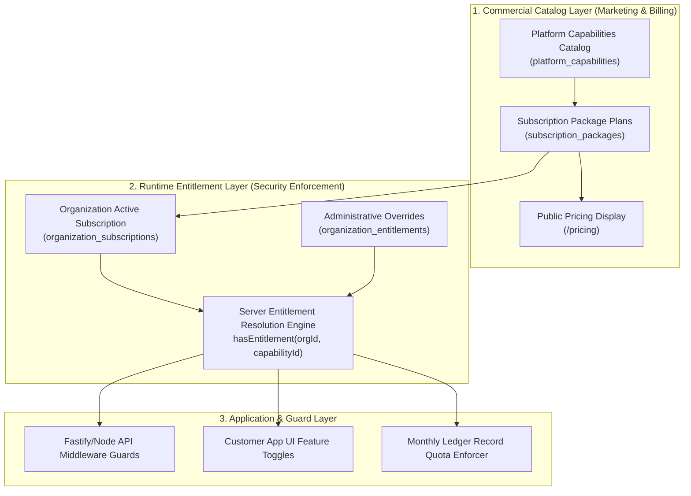
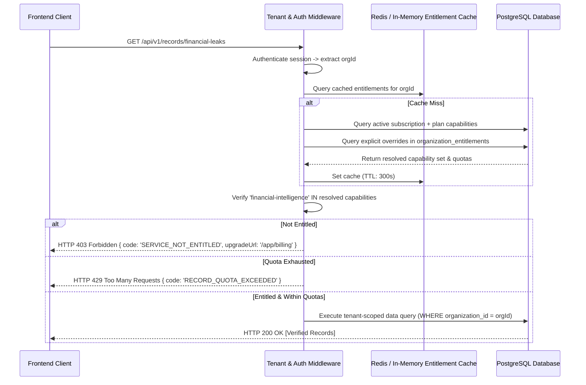
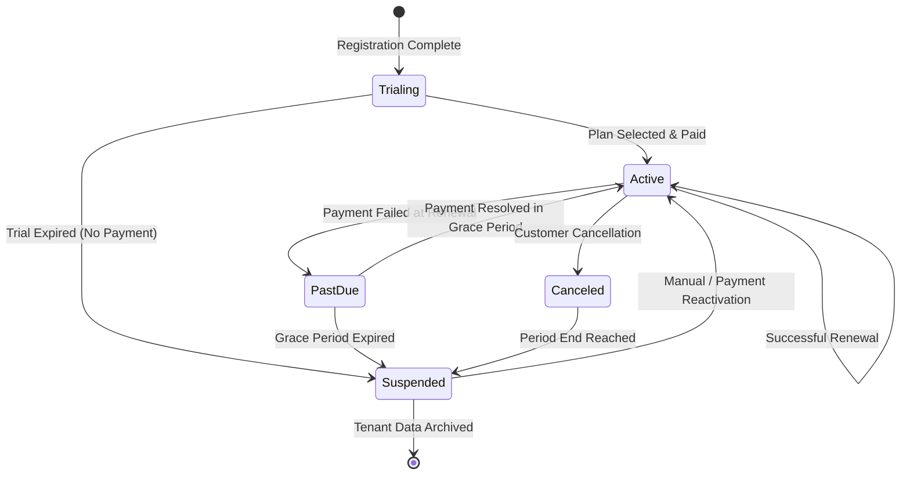

# SUBSCRIPTION_AND_ENTITLEMENT_SPECIFICATION.md
# MIKHLAFI LABS — Subscription & Entitlement Engine Specification
### COMMERCIAL PACKAGES, RUNTIME ENTITLEMENTS, USAGE ACCOUNTING & LIFECYCLE MANAGEMENT
**Author:** Principal Platform Architect & SaaS Systems Architect  
**Version:** 2.0.0 (Master Entitlement Blueprint)  
**Status:** Canonical Commercial & Technical Specification  
**Repository:** `d:\mikhlafi-labs` (`https://github.com/Saad2003Mouad/MkhlafiLabs`)

---

## 1. Architectural Foundation & Separation of Concerns

Conforming to **ADR 0002** (`docs/ADR/0002-catalog-entitlements.md`), MIKHLAFI LABS strictly decouples the commercial presentation layer from runtime security enforcement:



### Core Invariant
Application handlers and UI widgets **never** check `if (plan === 'enterprise')`. Application code only queries the capability gate: `hasEntitlement(organizationId, 'financial-intelligence')`. This allows the commercial team to restructure tiers, introduce custom bundles, or grant enterprise pilot waivers without modifying application code.

---

## 2. Commercial Package Definitions

| Package Identifier | Display Name | Target Profile | Price Model | Included Intelligence Engines | Max Branches | Max Member Seats | Monthly Record Quota | Support SLA |
|---|---|---|---|---|---|---|---|---|
| `plan_starter` | Starter Suite | Small businesses, clinics, single offices | Monthly / Annual | 1. Financial Intelligence<br>2. Executive Decisions<br>3. Data Quality | 1 Branch (HQ) | 5 Seats | 100,000 Records | Standard Docs |
| `plan_pro` | Professional Suite | Mid-market businesses, regional distributors | Monthly / Annual | 1. Financial Intelligence<br>2. Executive Decisions<br>3. Risk Intelligence<br>4. Supplier Intelligence<br>5. Data Quality | 5 Branches | 25 Seats | 1,000,000 Records | 24h SLA |
| `plan_enterprise` | Enterprise Suite | Multi-branch enterprises, contracting groups | Annual Contract | All 8 Canonical Engines:<br>(Financial, Decisions, Risk, Projects, Suppliers, Customers, AI Assistant, Data Quality) | Unlimited | 100 Seats | 10,000,000 Records | 4h Priority |
| `plan_sovereign` | Sovereign Mesh | Large groups, government entities, banks | Dedicated Quote | All 8 Engines + Air-gapped Mesh + Custom Domain Extensions | Unlimited | Unlimited | Unlimited | 24/7 Dedicated |

---

## 3. Server-Side Entitlement Resolution Engine

### 3.1 Authoritative Resolution Flow
When an organization requests access to any protected service capability, the resolution logic executes in strict order:



### 3.2 Service Availability States

| State Identifier | Business Meaning | Frontend Presentation | Backend Enforcement |
|---|---|---|---|
| `AVAILABLE_ACTIVE` | Capability is licensed, configured, and operational. | Full interactive view with live data and actions. | HTTP 200; mutations permitted. |
| `INCLUDED_UNCONFIGURED` | Licensed under active plan, but data source is not yet connected. | Informational setup banner with "Connect Data Source" button. | HTTP 200 with honest empty state. |
| `DISABLED_BY_ORG` | Licensed, but organization administrator explicitly disabled the module. | "Module paused by administrator" placeholder. | HTTP 403; access restricted. |
| `UPGRADE_REQUIRED` | Capability not included in current subscription package. | Locked state card with capability summary and "Upgrade Plan" CTA. | HTTP 403; `SERVICE_NOT_ENTITLED`. |
| `QUOTA_EXHAUSTED` | Monthly processing quota reached for the current billing cycle. | Warning banner: "Monthly quota reached (X/Y records). Upgrade capacity." | Read-only access allowed; new imports blocked (HTTP 429). |
| `SUBSCRIPTION_PAST_DUE` | Subscription renewal payment failed; grace period active (e.g., 7 days). | Persistent warning banner with payment update link. | Read-write allowed until grace period ends. |
| `SUBSCRIPTION_SUSPENDED` | Grace period expired or administrative suspension applied. | Full workspace lock; redirects to billing reconciliation screen. | HTTP 402/403 for all operational endpoints. |

---

## 4. Usage Accounting & Quota Enforcement

### 4.1 Tracked Resource Dimensions
1. **Audited Ledger Records (`monthly_records`):** Total count of transactional rows ingested and processed through intelligence pipelines during the calendar month. Reset at `00:00:00 UTC` on the first day of each billing cycle.
2. **Member Seats (`member_seats`):** Count of active user memberships where `status = 'active'`. Attempting to invite a new member beyond the plan limit returns HTTP 400 with a seat quota error.
3. **Branch Locations (`branch_count`):** Count of active branches. Creating a new branch beyond the limit returns HTTP 400.
4. **Connected Data Sources (`data_sources`):** Count of active database sync connectors or automated ERP feeds.

### 4.2 Database Schema for Subscriptions and Usage
The required schema expansion (to be applied in migration `002_subscription_and_catalog.sql`):

```sql
-- 1. Subscription Packages Catalog
CREATE TABLE subscription_packages (
  id                  VARCHAR(50) PRIMARY KEY, -- 'plan_starter', 'plan_pro', 'plan_enterprise'
  name_en             VARCHAR(100) NOT NULL,
  name_ar             VARCHAR(100) NOT NULL,
  tier_level          INT NOT NULL DEFAULT 1,
  monthly_price_cents INT NOT NULL DEFAULT 0,
  annual_price_cents  INT NOT NULL DEFAULT 0,
  currency            VARCHAR(10) NOT NULL DEFAULT 'SAR',
  max_branches        INT NOT NULL DEFAULT 1,
  max_members         INT NOT NULL DEFAULT 5,
  monthly_record_limit BIGINT NOT NULL DEFAULT 100000,
  is_public           BOOLEAN NOT NULL DEFAULT true,
  is_active           BOOLEAN NOT NULL DEFAULT true,
  created_at          TIMESTAMPTZ NOT NULL DEFAULT now()
);

-- 2. Platform Capabilities Catalog
CREATE TABLE platform_capabilities (
  id             VARCHAR(50) PRIMARY KEY, -- 'financial-intelligence', 'executive-decisions', ...
  name_en        VARCHAR(100) NOT NULL,
  name_ar        VARCHAR(100) NOT NULL,
  category       VARCHAR(50) NOT NULL DEFAULT 'intelligence',
  is_active      BOOLEAN NOT NULL DEFAULT true
);

-- 3. Package to Capability Mapping
CREATE TABLE package_capabilities (
  package_id    VARCHAR(50) NOT NULL REFERENCES subscription_packages(id) ON DELETE CASCADE,
  capability_id VARCHAR(50) NOT NULL REFERENCES platform_capabilities(id) ON DELETE CASCADE,
  PRIMARY KEY (package_id, capability_id)
);

-- 4. Organization Subscriptions
CREATE TABLE organization_subscriptions (
  id              UUID PRIMARY KEY DEFAULT gen_random_uuid(),
  organization_id UUID NOT NULL REFERENCES organizations(id) ON DELETE CASCADE,
  package_id      VARCHAR(50) NOT NULL REFERENCES subscription_packages(id),
  status          VARCHAR(50) NOT NULL DEFAULT 'trialing', -- 'trialing', 'active', 'past_due', 'suspended', 'canceled'
  billing_interval VARCHAR(20) NOT NULL DEFAULT 'monthly', -- 'monthly', 'annual', 'custom'
  current_period_start TIMESTAMPTZ NOT NULL DEFAULT now(),
  current_period_end   TIMESTAMPTZ NOT NULL,
  grace_period_end     TIMESTAMPTZ,
  canceled_at          TIMESTAMPTZ,
  created_at           TIMESTAMPTZ NOT NULL DEFAULT now(),
  updated_at           TIMESTAMPTZ NOT NULL DEFAULT now(),
  CONSTRAINT uq_org_subscription UNIQUE (organization_id)
);

-- 5. Monthly Usage Records
CREATE TABLE organization_usage (
  id              UUID PRIMARY KEY DEFAULT gen_random_uuid(),
  organization_id UUID NOT NULL REFERENCES organizations(id) ON DELETE CASCADE,
  period_key      VARCHAR(7) NOT NULL, -- '2026-10'
  records_processed BIGINT NOT NULL DEFAULT 0,
  updated_at      TIMESTAMPTZ NOT NULL DEFAULT now(),
  CONSTRAINT uq_org_usage_period UNIQUE (organization_id, period_key)
);
```

---

## 5. Subscription Lifecycle State Machine



### Invariants Governing Lifecycle Transitions
1. **Zero Data Loss on Suspension:** Suspending a tenant organization locks API write operations, but preserves all historical records, audit logs, and configurations intact.
2. **Audit Requirement:** Every subscription transition (payment success, renewal failure, administrative override, manual extension) generates an immutable entry in `audit_logs` referencing the acting user or payment webhook event.
3. **Payment Independence:** The platform is engineered to support pluggable payment processors (Stripe, Moyasar, HyperPay) or offline bank transfer approvals managed via the Platform Administration interface (`/admin/subscriptions`).
