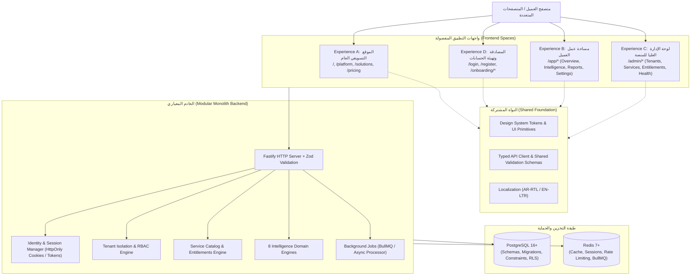

# TARGET_ARCHITECTURE.md
# MIKHLAFI LABS — البنية المعمارية المستهدفة للمنصة
### MASTER TARGET ARCHITECTURE SPECIFICATION
**Version:** 1.0.0 (Master Architecture Plan)  
**Status:** Approved Architectural Blueprint  

---

## 1. القيود المعمارية الحاكمة (Non-Negotiable Architecture Constraints)

| القيد المعماري | التبرير التقني والإلزامي |
|---|---|
| **الاعتماد الإلزامي لـ React + TypeScript** | يُحظر بناء أي واجهات جديدة بتقنية Vanilla JS. يُستخدم نظام بناء حديث (Vite) ووضع TypeScript الصارم (Strict Mode) لضمان موثوقية الأنظمة المؤسسية. |
| **الحياد القطاعي التام (Cross-Industry Neutral)** | لا ارتباط بأي قطاع أو عملة أو نموذج عمل محدد في النواة المشتركة. |
| **Monolith معياري (Modular Monolith)** | بناء الواجهة والخدمات الخلفية كوحدات معيارية في Monorepo موحد مع تجنب تشتيت الفريق في خدمات ميكروية سابقة لأوانها (Premature Microservices). |
| **عزل الصلاحيات وحماية البيانات بالكامل في السيرفر** | الواجهة الأمامية لا تتخذ أي قرار مصادقة أو تصريح. لا ثقة برقم المؤسسة المرسل من المتصفح دون تحقق السيرفر الصارم. |
| **حظر التخزين الصريح لكلمات المرور أو الأسرار** | التشفير بـ `argon2id` أو `bcrypt`. تخزين جميع المفاتيح والأسرار عبر متغيرات بيئة مدارة وخوادم أسرار. |
| **قاعدة بيانات علائقية متينة (PostgreSQL)** | استخدام PostgreSQL كنظام قاعدة البيانات الرئيسي الوحيد المعتمد مع Drizzle ORM للتعامل الخفيف والسريع مع البيانات. |
| **الجاهزية للنشر الذاتي والسحابي (Cloud & On-Premise Capable)** | لا اعتماد إلزامي على أي خدمة سحابية مغلقة أو خوادم AI مدفوعة. النظام قابل للتشغيل الذاتي الكامل دون إنترنت عند توافر بدائل محلية. |

---

## 2. فصل التجارب والحدود التطبيقية (Separation of Experiences)

يتم تقسيم المنصة إلى 5 تجارب استخدام مستقلة معمارياً، تشترك في نظام التصميم والخدمات الأساسية:

### تفصيل التجارب الخمس:
1. **Experience A — الموقع التسويقي العام (Public Marketing Website):**
   * مسارات عامة لا تتطلب تسجيل الدخول (`/`, `/platform`, `/capabilities`, `/solutions`, `/security`, `/deployment`, `/pricing`, `/about`, `/contact`, `/book-demo`).
   * التركيز على الشفافية التقنية، بناء الثقة، وجذب العملاء دون ادعاءات تسويقية زائفة أو شعارات وهمية.
2. **Experience B — مساحة عمل العميل والمؤسسة (Customer Application Workspace):**
   * محصورة تحت المسار `/app/*`.
   * تحتوي على لوحة القيادة التنفيذية، وحدات الذكاء الثمانية، التقارير والتحليلات، مصادر البيانات، وإعدادات المؤسسة والفروع.
3. **Experience C — إدارة المنصة الشاملة (Internal Platform Administration):**
   * محصورة تحت المسار `/admin/*`.
   * مساحة محصورة بمشغلي MIKHLAFI LABS لإدارة المؤسسات، الباقات، التراخيص، صحة المنصة، ومراقبة سجلات النظام. معزولة تماماً ولا تظهر للعملاء.
4. **Experience D — المصادقة والتهيئة (Authentication & Onboarding):**
   * مسارات مستقلة (`/login`, `/forgot-password`, `/reset-password`, `/onboarding/*`).
   * إدارة خطوات إنشاء المؤسسة، اختيار العملة واللغة، ودعوة الفريق خطوة بخطوة بطريقة قابلة للاستئناف (Resumable Onboarding).
5. **Experience E — النواة المشتركة (Shared Foundation):**
   * حزم مشتركة تضم التصميم المعياري، الترجمة AR/EN، مخططات التحقق Zod، وعميل الـ API المكتوب بنوعية صارمة (Type-Safe).

---

## 3. تقييم القرارات التقنية الأساسية (Core Technology Evaluation)

### 3.1 إطار العمل للواجهة (Frontend Framework): React + TypeScript + Vite
* **القرار:** استخدام **React 18/19** مع **TypeScript (Strict)** ونظام البناء **Vite**.
* **التبرير:**
  * يوفر Vite سرعة فائقة في البناء (Hot Module Replacement) وتوليد حزم خفيفة ومنضبطة.
  * يتيح تجزئة الكود (Route-based Code Splitting) لتقليل حجم التحميل الأولي للمستخدم.
  * يضمن التوافق المعياري مع نظام التصميم المشترك وتعدد اللغات دون الاعتماد على ميزات سحابية مغلقة.

### 3.2 إطار عمل الواجهة الخلفية (Backend Framework): Fastify + TypeScript
* **القرار:** استخدام **Fastify** مع **TypeScript** بنمط **Modular Monolith**.
* **التبرير:**
  * أداء أسرع بما يصل إلى 2 إلى 3 أضعاف مقارنة بـ Express.js التقليدي.
  * دعم مدمج قوي لـ JSON Schema والتحقق الصارم عبر `zod` أو `ajv`.
  * بنية معمارية تدعم الإضافات (Plugins architecture) لعزل الخدمات والوحدات داخلياً مع تشغيلها في سيرفر واحد موثوق.

### 3.3 محرك قاعدة البيانات وORM: PostgreSQL + Drizzle ORM
* **المقارنة بين Drizzle و Prisma:**
  * **Prisma:** يعتمد على محرك Rust ثنائي (Binary Engine) يضيف حجماً إضافياً وصعوبة أحياناً في البيئات الداخلية شديدة التقييد (Restricted On-Premises)، كما يسبب زيادة في استهلاك الذاكرة في الاستعلامات المركبة.
  * **Drizzle ORM:** خفيف للغاية (Zero-overhead)، يترجم استعلامات TypeScript مباشرة إلى SQL متوافق تماماً مع كفاءة وسرعة PostgreSQL، ويوفر تحكماً كاملاً بالـ Indexes و Row-Level Security و Migrations دون طبقات وسيطة خفية.
* **القرار المعتمد:** **PostgreSQL + Drizzle ORM**.

---

## 4. استراتيجية عزل المستأجرين (Tenant Isolation & Authorization)
* **المستوى الأول:** ربط كل سجل في الجداول بـ `organization_id` غير قابل للتعديل.
* **المستوى الثاني (سيرفر الـ API):** يستخرج وسيط السيرفر (Fastify Middleware) هوية المستخدم ومؤسسته الفعالة حصرياً من رمز الجلسة المشفر (Session / JWT Token)، ولا يقبل أي `organization_id` قادم من جسم الطلب (Request Body) أو العنوان (Query Param) دون التحقق الصارم من عضوية المستخدم وصلاحيته.
* **المستوى الثالث (قاعدة البيانات):** دعم تفعيل **PostgreSQL Row-Level Security (RLS)** لضمان استحالة تسرب البيانات بين المؤسسات حتى في حال حدوث خطأ برمجي غير مقصود في الاستعلامات.

---

## 5. نموذج النشر المزدوج (Cloud & On-Premises Strategy)
1. **النشر السحابي التقليدي (Hosted Deployment):**
   * تشغيل النظام على حاويات Docker أو خوادم مدارة، مع قاعدة بيانات PostgreSQL مدارة وتخزين آمن للمفاتيح.
2. **النشر الذاتي / الداخلي (Customer-Controlled / On-Premise):**
   * إمكانية حزم المنصة عبر `docker compose` موحد يشمل (الواجهة، الخادم، قاعدة بيانات PostgreSQL، وRedis).
   * **التشغيل دون إنترنت (Offline Capability):** توفير بدائل محلية لجميع العمليات الحيوية:
     * التحليل والتقارير والذكاء المالي يعمل محلياً بنسبة 100%.
     * المساعد الذكي (AI Assistant) يعمل عبر محول يدعم النماذج المحلية (Ollama / Local LLM) بدلاً من نماذج السحابة.
     * توثيق واضح للميزات التي تتطلب إنترنت (مثل إرسال البريد الخارجي وبوابات الدفع البنكية).
