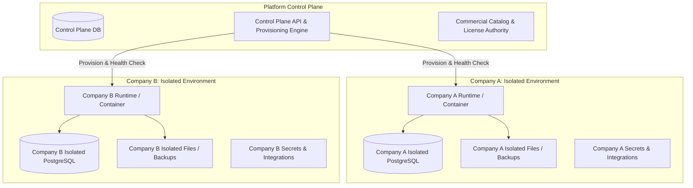
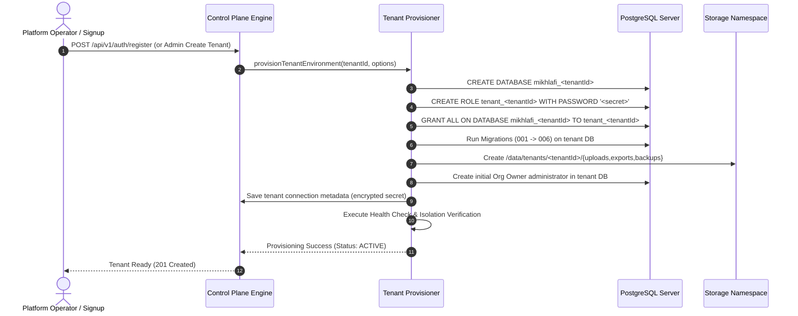

# MIKHLAFI LABS — Tenant Isolation & Operational Environment Architecture
**Document Version:** 2.0.0  
**Target Specification:** Control Plane + Isolated Company Environments  
**Deployment Models:** Cloud Edition (Multi-Tenant Containerized Mesh) & Private Edition (Sovereign On-Premises)

---

## 1. Executive Summary & Core Principle

In MIKHLAFI LABS, tenant isolation is not merely a software filter (e.g. `WHERE tenant_id = '...'`). The platform mandates **genuine operational environment isolation per company**:

- **Company A** operates in an isolated environment with its own database credentials, database/schema, uploaded files, integration secrets, backups, and AI context.
- **Company B** operates in an isolated environment with separate credentials, database/schema, files, secrets, and backups.
- **Under no circumstances** can Company B read, mutate, infer, or access Company A's information, even in cases of malicious SQL parameter injection, URL tampering, or internal credential leaks.



---

## 2. Control Plane vs. Tenant Operational Environments

### 2.1 The Control Plane (Platform Level)
The Control Plane is responsible exclusively for platform orchestration, commercial lifecycle, and operational health. It does **not** store confidential customer ledgers, transactional journal entries, supplier contracts, or fraud investigation evidence.

**Control Plane Responsibilities:**
1. **Tenant Registry:** Unique tenant ID, slug, deployment mode (`cloud` or `private`), provisioning state (`PROVISIONING`, `ACTIVE`, `SUSPENDED`, `DECOMMISSIONED`).
2. **License Authority:** License issuance, RSA signature verification, expiration, and entitlement bitmasks.
3. **Subscription & Billing:** Commercial package tiers (Starter, Pro, Enterprise, Sovereign), billing intervals, and resource quota limits.
4. **Platform Operator Management:** Superuser authentication (`is_platform_admin = true`), platform audit logs, and lead inquiry management.
5. **Provisioning Orchestration:** Provisioning isolated runtime containers, creating databases, generating credentials, and running initial migrations.

### 2.2 The Tenant Operational Environment (Company Level)
Each registered company receives an isolated operational boundary containing:
1. **PostgreSQL Database & Credentials:** Dedicated database (or isolated schema with restricted database role) with credentials having zero permissions to access any other tenant's schema or the Control Plane.
2. **Filesystem Namespace:** Dedicated storage path `data/tenants/<tenant_id>/` with segregated subdirectories:
   - `uploads/`: Ingested ERP CSV/Excel files and source documents.
   - `exports/`: Generated PDF executive reports and RFC 4180 CSV exports.
   - `backups/`: Encrypted point-in-time PostgreSQL dumps.
3. **Integration Secrets & ERP Connections:** AES-256-GCM encrypted database credentials, API tokens, and webhook keys used for reading customer SAP/Oracle ERPs.
4. **Internal Users, RBAC & Audit Trails:** Company-specific users, roles (`org_owner`, `org_admin`, `manager`, `analyst`, `viewer`), branch hierarchy, and forensic action audit logs.
5. **Intelligence Engines & Local AI Cache:** Domain calculation results, anomaly records, and local AI prompt context.

---

## 3. Cloud Edition vs. Private Edition

| Architectural Attribute | Cloud Edition | Private Edition |
| :--- | :--- | :--- |
| **Hosting Model** | Managed multi-tenant cloud or dedicated VPC | Customer self-hosted on bare-metal, VM, or local Kubernetes |
| **Control Plane Connection** | Direct internal RPC / secure REST to Control Plane | Autonomous single-tenant runtime; air-gapped from cloud Control Plane |
| **Database Isolation** | Dynamic per-tenant PostgreSQL database / dedicated pool | Dedicated customer-managed PostgreSQL database instance |
| **Licensing Mechanism** | Continuous subscription validation via Control Plane | Cryptographically signed offline license file (RSA-4096 / HMAC) |
| **AI Processing** | Local heuristic + optional managed Ollama / external API | 100% local heuristic and local Ollama/vLLM model; zero external calls |
| **Data Residency** | Region-locked cloud storage (e.g. Saudi Arabia / ME) | Completely sovereign inside customer firewall and perimeter |
| **Backup Management** | Automated scheduled tenant-level encrypted dumps | Local cron/operator automated backup scripts to on-premises storage |

---

## 4. Multi-Tenant Database Isolation Architecture

In Cloud Edition, database isolation is implemented using the **Dynamic Tenant Database Manager (`tenantDbManager`)**:

```
Client HTTP Request
       │
       ▼
Auth & Session Middleware (validates user & resolves active tenant)
       │
       ▼
Tenant Context (tenant_id = 'c0000000-0000-0000-0000-000000000002')
       │
       ▼
tenantDbManager.getTenantDb(tenantId)
       │
       ├─► Cloud Mode (PostgreSQL Pool Pooler):
       │   Connects to dedicated tenant DB: postgres://tenant_c000:pass@db:5432/mikhlafi_c000
       │   Role permissions: Restricted ONLY to database mikhlafi_c000
       │
       └─► Embedded/Dev Mode (PGlite):
           Connects to isolated directory: ./data/tenants/c000/db/
```

### Safety Rules Enforced by `tenantDbManager`:
1. **Zero Global Cross-Querying:** The tenant application connection pool uses credentials with rights strictly limited to that tenant's database. Even if raw SQL injection were executed, PostgreSQL will reject any query attempting to touch another tenant's tables (`CROSS-DATABASE PERMISSION DENIED`).
2. **Server-Side Tenant Derivation:** The client browser *never* specifies a database connection string. The tenant identifier is derived strictly from the cryptographically verified session token.
3. **Connection Pooling & Lifecycle:** Each tenant pool has configurable idle timeouts (default 30s) and maximum connection caps (default 5 per tenant in shared mode) to prevent resource starvation (Noisy Neighbor protection).

---

## 5. Tenant Provisioning & Lifecycle Automation



### 5.1 Rollback on Failure
If any provisioning step fails (e.g. migration error, storage failure), the provisioner initiates an immediate automatic rollback:
1. Terminate any active connections to the partial database.
2. Execute `DROP DATABASE IF EXISTS mikhlafi_<tenantId>`.
3. Execute `DROP ROLE IF EXISTS tenant_<tenantId>`.
4. Delete temporary directories in `data/tenants/<tenantId>/`.
5. Mark tenant status in Control Plane as `PROVISIONING_FAILED` with error diagnostics.
6. **No orphaned databases, credentials, or filesystem nodes are left behind.**

### 5.2 Tenant Suspension & Reactivation
- **Suspension:** Operator invokes `PUT /api/v1/admin/organizations/:id/status` with `suspended`.
- The Control Plane updates tenant status, instantly revokes all active session tokens for that tenant's users, and instructs `tenantDbManager` to terminate the connection pool.
- Any subsequent API requests from the tenant return `403 Forbidden (Organization Suspended)`.
- **Reactivation:** Reverses status, allowing administrators to log in while preserving all historical data and audit trails intact.

### 5.3 Single-Tenant Backup & Point-in-Time Restore
- Independent backup command:
  ```bash
  pg_dump -U tenant_<tenantId> -d mikhlafi_<tenantId> -Fc -f /data/tenants/<tenantId>/backups/backup_<timestamp>.dump
  ```
- Restoring Company A never affects or locks Company B's database.

---

## 6. Cryptographic Offline License Validation (Private Edition)

For Private Edition, the customer application runs completely disconnected from the Internet. Licensing is validated using digital signatures:

### License File Structure (`license.json`):
```json
{
  "licenseId": "LIC-2026-SAUDI-001",
  "customerSlug": "aram-logistics",
  "customerName": "Aram Logistics Co.",
  "edition": "PRIVATE_EDITION",
  "tier": "enterprise",
  "issuedAt": "2026-10-01T00:00:00Z",
  "expiresAt": "2027-10-01T00:00:00Z",
  "maxMembers": 100,
  "maxBranches": 25,
  "licensedCapabilities": [
    "financial-intelligence",
    "executive-decisions",
    "data-quality",
    "risk-intelligence",
    "supplier-intelligence",
    "customer-intelligence",
    "project-intelligence",
    "ai-assistant"
  ],
  "signature": "3a8f90c1...[HMAC-SHA256 or RSA-4096 Sign]"
}
```

### Offline Validation Lifecycle:
1. Customer mounts `license.json` or configures `LICENSE_KEY` environment variable.
2. At boot and during periodic cron checks, `licenseManager.verifyLicense()` validates the cryptographic signature using the embedded public key / shared verification secret.
3. If valid and not expired, licensed capabilities are enabled.
4. **Maintenance Expiry Policy:** When the maintenance contract period expires, the customer retains perpetual access to the platform version they purchased, while upgrades to newer versions are disabled. **Customer business data is never locked out.**
